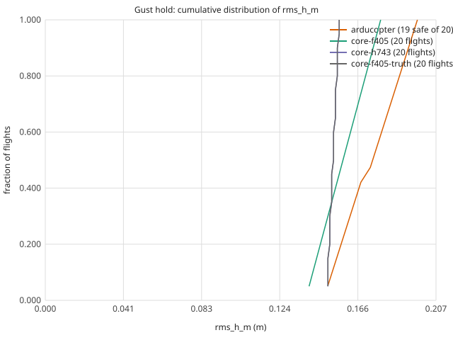
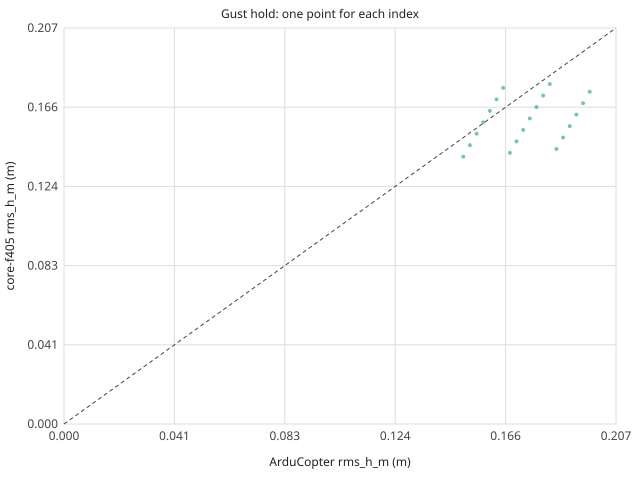

# Gate 1 report

**Verdict: NOT PASSED**

This is not the gate's plan, so it is not passed whatever the numbers say:

- gust-hold is flown on 20 indices and the record says 500
- gps-loss is flown on 3 indices and the record says 10
- the scenario gps-loss-pilot is not in the plan
- the scenario gps-loss-recovers is not in the plan
- the scenario baro-loss is not in the plan
- the scenario mag-loss is not in the plan
- the scenario rc-loss-position is not in the plan
- the scenario rc-loss-override is not in the plan
- the scenario rc-loss-on-ground is not in the plan
- the scenario rc-loss-offboard-gcs is not in the plan
- the scenario gcs-loss is not in the plan
- the scenario no-human-link is not in the plan
- the scenario battery-low is not in the plan
- the scenario battery-critical is not in the plan
- the scenario geofence is not in the plan
- the scenario brain-crash is not in the plan
- the scenario brain-hang is not in the plan
- the scenario setpoint-gap is not in the plan
- the scenario pair-battery-critical+baro-loss is not in the plan
- the scenario pair-battery-critical+brain-crash is not in the plan
- the scenario pair-battery-critical+geofence is not in the plan
- the scenario pair-battery-low+baro-loss is not in the plan
- the scenario pair-battery-low+battery-critical is not in the plan
- the scenario pair-battery-low+brain-crash is not in the plan
- the scenario pair-battery-low+geofence is not in the plan
- the scenario pair-brain-crash+baro-loss is not in the plan
- the scenario pair-brain-crash+geofence is not in the plan
- the scenario pair-geofence+baro-loss is not in the plan
- the scenario pair-gps-loss+baro-loss is not in the plan
- the scenario pair-gps-loss+battery-critical is not in the plan
- the scenario pair-gps-loss+battery-low is not in the plan
- the scenario pair-gps-loss+brain-crash is not in the plan
- the scenario pair-gps-loss+geofence is not in the plan
- the scenario pair-rc-loss+baro-loss is not in the plan
- the scenario pair-rc-loss+battery-critical is not in the plan
- the scenario pair-rc-loss+battery-low is not in the plan
- the scenario pair-rc-loss+brain-crash is not in the plan
- the scenario pair-rc-loss+geofence is not in the plan
- the scenario pair-rc-loss+gps-loss is not in the plan
- motor-loss is flown on 5 indices and the record says 10
- the scenario imu-loss is not in the plan
- the scenario kill-in-rtl is not in the plan
- the flights flown twice are [("gust-hold", 2), ("gps-loss", 1)] and the record says [("gust-hold", 5), ("gps-loss", 1), ("battery-low", 1), ("rc-loss-offboard-gcs", 1), ("imu-loss", 1), ("pair-gps-loss+baro-loss", 1)]

Commit `0123456789abcdef0123456789abcdef01234567`, clean tree.

## The criteria

### A1: HOLDS

- core-f405: 20 of 20 flights are safe and pass the scenario file's limits
- core-h743: 20 of 20 flights are safe and pass the scenario file's limits

### A2: HOLDS

- ArduCopter: 1 of 20 flights are not safe and are left out of its statistics
- median: core-f405 0.15900000000000003 m, ArduCopter 0.175 m (ours at most theirs)
- 95th percentile: core-f405 0.1761 m, ArduCopter 0.19525 m (ours at most theirs)

### B1: HOLDS

- gps-loss: core-f405 0 crash or fly-away, ArduCopter 1

### B2: HOLDS

- gps-loss: core-f405 3 of 3 flights safe and pass

### B3: HOLDS

- motor-loss: median time from the failure to motors off, core-f405 0.1999999999999993 s, ArduCopter 2 s
- motor-loss: core-h743 (reported, decides nothing) 0.1999999999999993 s

### Repeats: HOLDS

- 3 flights flown twice, 3 repeat bit for bit and match the main table

## Criterion A: holding position in gusts

RMS horizontal error from the hold point, m. ArduCopter's statistics are over its safe flights only; the others are over all their flights.

| autopilot | flights | not safe | counted | median | 95th percentile | mean | worst | vertical RMS median | vertical RMS worst | tilt median (deg) | tilt worst (deg) |
|---|---|---|---|---|---|---|---|---|---|---|---|
| arducopter | 20 | 1 | 19 | 0.1750 | 0.1953 | 0.1739 | 0.1975 | 0.0500 | 0.0500 | 9.5000 | 9.5000 |
| core-f405 | 20 | 0 | 20 | 0.1590 | 0.1761 | 0.1590 | 0.1780 | 0.0500 | 0.0500 | 9.5000 | 9.5000 |
| core-h743 | 20 | 0 | 20 | 0.1530 | 0.1560 | 0.1528 | 0.1560 | 0.0500 | 0.0500 | 9.5000 | 9.5000 |
| core-f405-truth | 20 | 0 | 20 | 0.1530 | 0.1560 | 0.1528 | 0.1560 | 0.0500 | 0.0500 | 9.5000 | 9.5000 |

Lower `rms_h_m`: core-f405 in 16 indices, ArduCopter in 4, equal in 0.





The curves and the points are over ArduCopter's safe flights: an index where its flight is not safe is not drawn.

## Criterion B: failures

Classes are safe / crash / fly-away. "Passed" counts the rows whose verdict column says pass.

| scenario | scored | core-f405 | core-f405 passed | core-h743 | core-h743 passed | ArduCopter |
|---|---|---|---|---|---|---|
| gps-loss | on the outcome | 3 / 0 / 0 | 3 of 3 | 3 / 0 / 0 | 3 of 3 | 2 / 0 / 1 |
| motor-loss | on the time to motors off | 5 / 0 / 0 | 5 of 5 | 5 / 0 / 0 | 5 of 5 | 5 / 0 / 0 |
| hover-step | not scored | 2 / 0 / 0 | 2 of 2 | 2 / 0 / 0 | 2 of 2 | 2 / 0 / 0 |

## Time from the failure to motors off

| scenario | failure at (s) | core-f405 median (s) | core-h743 median (s) | ArduCopter median (s) |
|---|---|---|---|---|
| motor-loss | 15 | 0.2000 | 0.2000 | 2.0000 |

## Flights flown twice

| scenario | index | repeats | hashes as in the main table |
|---|---|---|---|
| gust-hold | 0 | yes | yes |
| gust-hold | 1 | yes | yes |
| gps-loss | 0 | yes | yes |

## gate.txt

```text
oxide-bridge gate 1
commit 0123456789abcdef0123456789abcdef01234567
tree clean
scope reduced
binary sha256 b1b1b1b1b1b1b1b1b1b1b1b1b1b1b1b1b1b1b1b1b1b1b1b1b1b1b1b1b1b1b1b1
binary path /x/arducopter
command line oxide-bridge gate fly
first started 2026-01-01T00:00:00Z
started 2026-01-01T00:00:00Z
ended 2026-01-01T09:00:00Z
cores 4
param file base.parm sha256 aa
scenario file gust-hold sha256 000000000000000000000000000000000000000000000000d8f15a870eae7dfc
scenario file gps-loss sha256 000000000000000000000000000000000000000000000000b468b655d2ef3065
scenario file motor-loss sha256 000000000000000000000000000000000000000000000000b8c2af46c15b0502
scenario file hover-step sha256 0000000000000000000000000000000000000000000000002505a74ceb73eeca
plan gust gust-hold 20
plan outcome gps-loss 3
plan motors-off motor-loss 5
plan not-scored hover-step 2
twice gust-hold 2
twice gps-loss 1
failure motor-loss 15
```
