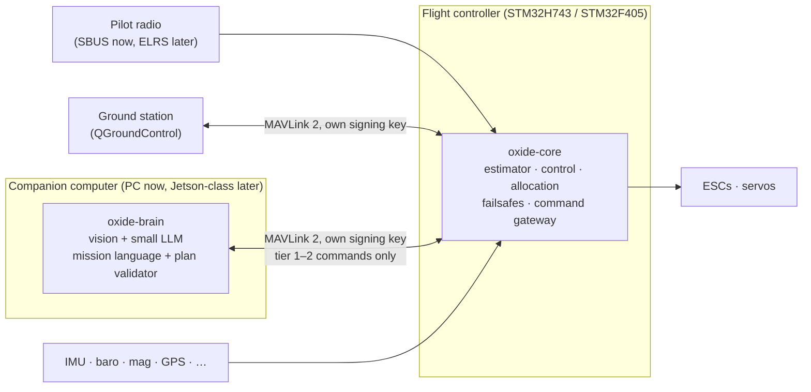

# Airborne Oxide — System Design

**Status:** v0.2 (revised after design review), accepted 2026-11-09 · **Date:** 2026-11-04 · **Owner:** Daniel Biocchi

This document records the design decisions the project was started from.
Changes since are recorded as short decision records (ADRs) in `docs/adr/` and folded back in here.

Decision numbers (Q1–Q39) refer to the design interview, and each is listed in [Appendix A](#appendix-a-decision-log).
[Appendix B](#appendix-b-design-review-2026-11-04) lists what the independent design review changed.

---

## 1. What we are building

Airborne Oxide is flight software written in Rust ("rust in the air"). It has three parts, in order of importance:

1. **A simulator.** Good enough to design flight algorithms *and airframes* in. It is deterministic, fast enough to fly thousands of test flights per commit, and calibrated against real flights.
2. **A flight core.** A small, verified, hard-real-time flight controller. It flies any airframe and stays safe whatever the AI does.
3. **An AI brain.** Computer vision plus a small on-board language model that makes mission decisions. Today it runs on a companion computer. The design assumes it will move onto smaller drones as AI hardware shrinks.

The target is software lighter than ArduPilot, built around on-board AI from day one, and verified more rigorously than existing autopilots.

## 2. Principles

1. **The simulator is the flagship.** It gets the most effort, and it should be the best open-source drone simulator for algorithm and airframe development. (Q11, Q12)
2. **The flight core is the base.** It is deterministic, never allocates on the heap, and is written not to panic. It has a defined, tested behaviour for faults that do happen (§4.16). It flies, and fails safe, with the brain dead or missing. (Q3, Q6)
3. **Numbers decide.** Our core earns its place by beating ArduPilot and PX4 in fair, identical simulated scenarios (§8). If it can't, ArduPilot flies the real drones and the effort goes into the simulator and brain. (Q9)
4. **The AI is untrusted input.** The brain proposes; the flight core enforces the limits. The pilot's radio outranks everything, under defined rules. (Q4, Q10)
5. **Build to scale, not build small.** Written to fit an STM32F405, and configured up on an STM32H7 rather than stretched. (Q13)
6. **Fly, calibrate, repeat.** The simulator is trusted only after it matches real flight data. (Q12, Q19)

## 3. System architecture

In simulation, `oxide-sim` takes the place of the hardware. It owns the clock, drives the *same* `oxide-core` code through the core interface (§4.2), and feeds it simulated sensors. The same simulator can also fly ArduPilot SITL and PX4 SITL for benchmarking (§8).

### Components (Q39)

| Crate | Role | Runs on |
|---|---|---|
| `oxide-core` | Flight core library: the task schedule, estimator, control laws, control allocation, failsafes, command gateway, mission store, parameters, logging. `no_std`, no `alloc`, no framework. Its `io` module defines all inputs, outputs and log records. | MCU and host |
| `oxide-fw-h743`, `oxide-fw-f405` | Board firmware: drivers and RTIC 2 tasks around `oxide-core`. | MCU |
| `oxide-sim` | Simulator: physics, sensors, environment, faults, scenarios, SITL bridges, Python bindings. | PC / CI |
| `oxide-lab` | Airframe lab: airframe files, geometry, mass properties, aerodynamics pipeline, auto-tune, scorecards, optimizer. | PC |
| `oxide-brain` | Companion AI: perception, planner, mission language, plan validator. | PC now, companion later |

Anything that needs a heap (scripting, log upload) lives in a separate crate that the F405 profile doesn't link. The simulator may get its own brand name before anything is published.

---

## 4. Flight core

### 4.1 Targets, build profiles and budgets (Q13)

| | F405 "lean" | H743 "full" |
|---|---|---|
| Role | Constrained target. CI keeps it building within its size and stack budgets; timing is measured on the bench (§9). | Main reference target |
| Rate loop | ~1–2 kHz | up to 4–8 kHz |
| IMUs / estimators | 1 IMU, 1 estimator. **No IMU redundancy: losing the only IMU is terminal** (§4.10). | Several IMUs, each with its own estimator ("lanes"), cross-checked and voted |
| Filtering | Static notch + low-pass | FFT-based dynamic notch |
| Estimator precision | f32 | f32 or f64, whichever the simulator shows is worth it |

Both profiles build from the same source; each profile picks its rates, capacities and features at compile time.

**Resource budgets.** A per-profile budget table lists cycles per call, % CPU, flash and RAM (split into DMA-reachable RAM and CCM/DTCM) for each of: rate loop, filtering, estimator (per lane), control, allocation, comms (MAVLink and signing), logging, parameters, and headroom. It is filled in from the first bench measurements. These ceilings are fixed now:
- **F405:** worst-case CPU ≤ 60 %; flash ≤ 75 % of 1 MB, with two sectors reserved for parameters; RAM ≤ 75 %.

### 4.2 Runtime and the core interface (Q14)

`oxide-core` is a plain library with no framework and no global state. The simulator tests the real multi-rate behaviour, not a harness of its own, because of the following contract:

- **The core owns the schedule.** Each profile defines a const task table: every task, its period as a whole number of base ticks, and its order within a tick. For example, on the F405: IMU, filtering, rate control and allocation every tick; estimator every 4–10 ticks; outer loops at 50–250 Hz; failsafes and gateway at 50 Hz.
- **Entry point:** `Core::tick(now_us, &Inputs) -> Outputs`.
- **Timestamped inputs.** Each input is a sample `{source, t_sample_us, t_arrival_us, payload}`, and each output carries `t_valid_us`. These types live in `oxide-core::io`.
- **Logical-execution-time rule.** A task reads its inputs at the start of its period, and its outputs become visible to other tasks at the end of it. This fixes a one-period latency per profile, so results don't depend on how RTIC preempts tasks, as long as every deadline is met. Firmware checks deadlines and counts overruns, and an overrun is a logged fault.
- **Firmware only adapts.** It turns interrupt and DMA completions into samples and applies outputs. RTIC priorities mirror the core's task table.
- **The simulator** applies a compute-and-output latency model per task: one rate-loop period by default, later the worst case measured on the chip. CI runs both profiles' task tables in the simulator.
- **Integration spike.** Before F405 bring-up, a spike on the bench F405 builds RTIC 2 with embassy-stm32, reads the IMU over SPI with DMA at the target rate, and drives one motor output. The interrupt-binding approach and the measured latency and jitter go in an ADR. If this doesn't work cleanly, the fallback is RTIC 2 with `stm32f4xx-hal`/`stm32h7xx-hal` or PAC-level drivers for the hot path.

### 4.3 Numbers, units, frames and time (Q13)

- **Control laws:** `f32`.
- **Estimator:** generic over `f32`/`f64`, generated from one symbolic derivation, with the profile picking the precision.
- **Global position:** latitude/longitude as `f64` or integer 1e-7 degrees (the MAVLink convention). Local position uses a North-East-Down (NED) frame near the origin.
- **Time:** `u64` microseconds since boot, in a newtype. Driver-level `u32` timestamps are widened at the boundary, and time differences use checked or saturating arithmetic. Time is never a float. (A `u32` in microseconds wraps after 71.6 minutes.)
- **Frames:** world NED, body Forward-Right-Down (the MAVLink / PX4 / ArduPilot convention).
- **Units:** SI everywhere, with a distinct type per physical quantity so the compiler rejects unit mix-ups.
- **Maths functions:** everything goes through one wrapper (`oxide-core::math`) built on the `libm` crate, on host and MCU alike. Host builds are bit-identical on Windows and Linux (§5.2). Agreement between host and MCU is *checked*, using replay and hardware-in-the-loop golden traces (S4); it is not assumed.

### 4.4 Memory (Q13)

- `oxide-core` is strictly heap-free (`no_std` without `alloc`). Buffers are sized at compile time with const generics; the H743 profile simply sets larger sizes.
- The mission store that §4.8 needs is fixed-capacity, checksummed, and lives in `oxide-core`.
- **Memory map per chip.**
  - **CCM (F405) / DTCM and ITCM (H743):** stacks and core state.
  - **DMA-reachable SRAM:** SPI, UART, SD and DShot buffers.
  - **Placement:** named linker sections decide what goes where.
  - **H743 cache:** DMA buffers sit in a non-cacheable MPU region, or drivers clean and invalidate the cache explicitly.

### 4.5 Vehicle support and control allocation (Q1, Q8)

- **Shared core:** estimator, safety, comms, logging, control allocation. Each vehicle class adds a control-law module on top.
- **Control allocation:** constrained weighted least squares using the active-set method. It is **our own clean-room implementation** from the published literature (e.g. Härkegård 2002), written without reading GPL sources, or a port of PX4's BSD-3 control allocator. `wls-alloc` is **not** used: it is labelled MIT but describes itself as a port of TU Delft's GPL-3.0 ActiveSetCtlAlloc (§10). We write bounded Kani proofs for it (§9).
- **Order:** **Quad-X**, then hex/octo (nearly free via allocation), then fixed-wing, then tilt-rotor VTOL (the Titan Viper).

### 4.6 Control (Q17)

- **Baseline:** cascaded PID: position → velocity → attitude (quaternion) → body rate.
- **INDI** (incremental nonlinear dynamic inversion) gets a slot at the rate/attitude level for disturbance rejection, and is compared against PID in the simulator's gust and fault scenarios.
  - **RPM input:** it uses motor RPM when the reading is fresh. When telemetry is stale or absent, it falls back to an RPM estimate from commanded throttle, battery voltage and the motor model.
  - **Testing:** stale RPM telemetry is a fault-injection case.
- **MPC** comes later, for trajectory tracking.

### 4.7 State estimator (Q26)

- Our own error-state EKF, built on the architecture of PX4's EKF2 (BSD-3; ported files keep PX4's notices, §10).
  - IMU data is integrated into delta angles and delta velocities at the rate-loop rate.
  - State and covariance prediction, and all measurement fusion, run at a fixed filter rate on a delayed time horizon. The rate is 100–250 Hz and divides the rate loop exactly; PX4's default is 10 ms.
  - An output predictor brings the state forward to the current time at the rate-loop rate.
  - Innovations are gated.
- The equations are derived symbolically (Python/SymPy) and emitted as generated Rust in f32 or f64 from one source. The generated functions are tested against the symbolic derivation; small kernels are checked for no NaN and no panic on bounded inputs.
  - **First version (M1b, [ADR-0002](adr/0002-estimator.md)):** the 15 error-state equations are written by hand, generic over f32/f64, and checked against numerical derivatives in f64. Code generation follows when the state grows.
- PX4's EKF2 is the benchmark reference in the simulator. An invariant EKF is a later simulator experiment.

### 4.8 Command authority and the command gateway (Q4, Q37)

Brain commands come in tiers. Every tier exists in the protocol, and a configuration and safety policy decides which are enabled.

| Tier | Command | Typical rate | Status |
|---|---|---|---|
| 1 | Mission / intent ("survey this area", "land there") | ~0.1–1 Hz | Enabled |
| 2 | Trajectory: position / velocity / acceleration / yaw targets | 20–50 Hz | Enabled |
| 3 | Attitude + thrust | ~100 Hz | Disabled, and compiled out of release builds |
| 4 | Body rates + thrust | ~100+ Hz | Disabled, and compiled out of release builds |

**The command gateway** treats every brain message as untrusted. It validates and clamps commands to the flight limits (tilt, speed, altitude, geofence, terrain clearance), rejects stale ones, and revokes authority after repeated violations. The brain never controls motors directly.

**Link authority.**
- **Separate links.** The ground station and the brain each have their own port and their own MAVLink signing key, so the core knows which link a message came from. Authority follows the link, not the MAVLink system ID.
- **Authority matrix.** A matrix (message or command × RC/GCS/brain × disarmed/armed) is the gateway's specification, written as an ADR before M3.
- **What the brain may send:** only tier 1–2 messages, heartbeats and read requests. It may **not** send:
  - parameter writes;
  - arm/disarm;
  - mode changes outside its tiers;
  - geofence, limit or mission-policy edits;
  - reboot or bootloader commands.
- **Safety parameters** (failsafe actions, limits, geofence, tier enablement, keys) can be written only from the GCS link, and only while disarmed.
- **Strikes:** they are counted within a window (default 3 in 60 s). Revoked authority is re-granted only by the pilot or the ground station.

**Missions and brain loss.**
- **Missions live on the core.** Tier-1 missions are uploaded to and stored on the core, so it can keep flying them without the brain (§4.10, brain-loss row).
- **Heartbeat:** the brain sends one at ≥ 4 Hz, carrying a planner-progress counter.
- **Staleness** is judged on the core's own receive time, so no clock sync is needed for safety. Tier-1 commands are not subject to the 0.5 s tier-2 staleness rule.

### 4.9 Command priority, kill switch and pilot override (Q10)

1. **Kill switch.** It has a dedicated RC channel and stops the motors, on the ground and in flight.
   - **Valid frames only:** it acts only on frames that carry no failsafe or frame-lost flag, and only after the kill position has been seen in 3 consecutive frames. RC loss is never read as kill, or as un-kill. The arm switch is confirmed the same way, so one corrupted frame can neither arm nor disarm (ADR-0003 §6).
   - **Latching:** it latches. Motors stay off until the switch is released and the vehicle is re-armed through the normal checks (§4.11).
2. **Pilot (sticks and mode switch).** Outranks everything below, including a failsafe in progress, under these rules:
   - **(a) A valid link first.** RC must have delivered valid frames (no failsafe or frame-lost flag) for at least 1 s (a parameter) before pilot input counts. RC coming back does not, on its own, end a failsafe.
   - **(b) Explicit overrides.** An override is a deliberate mode-switch change, not stick movement.
   - **(c) Mode preconditions.** The core enters a requested mode only if it currently meets that mode's preconditions; position modes, for example, need a healthy position estimate. Otherwise it enters the best available stabilised mode and tells the pilot.
   - **(d) Restricted failsafes.** During battery-critical, estimator-unhealthy and IMU-failure failsafes, the pilot can take over only into a stabilised (attitude or altitude) mode.

   Every override is logged.
3. **Flight-core safety:** failsafes and flight limits.
4. **Ground station.**
5. **Brain.**

### 4.10 Failsafes, multirotor defaults (Q28)

All actions are configurable, and the pilot can override under the rules in §4.9. Timings are starting values to be tuned in the simulator.

| Event | Default action |
|---|---|
| RC lost during manual or stabilised flight | Hold for 3 s, then return to launch (RTL) |
| RC lost during an autonomous mission | Continue the mission (a per-mission setting), up to a maximum time without any human link (RC or GCS); then RTL |
| Ground station lost | Continue; RTL if RC is also lost |
| Brain heartbeat lost (planner-progress counter unchanged for > 2 s) | Continue the mission stored on the core for up to `BRAIN_LOSS_TIMEOUT` (default 60 s, longer than a companion reboot), then RTL. With no stored mission: Hold, then RTL after 10 s. |
| Tier-2 setpoints stale (> 0.5 s since receipt while tier 2 is active) | Hold |
| Brain command invalid or out of limits | Reject or clamp, log, alert. After 3 strikes in 60 s, revoke brain authority and Hold. |
| Battery low | Warn, then RTL |
| Battery critical | Land now |
| GPS lost | Hold altitude and level attitude with velocity damping; Land if GPS isn't back within 30 s |
| Estimator unhealthy | Switch lane (H743). If none is healthy, Land now on attitude only. |
| Geofence breached | RTL |
| IMU failure | **H743:** switch IMU lane. **F405 (one IMU):**  • try to recover the sensor (bus reset and re-initialisation within a bounded time, holding the last outputs);  • partial faults (clipping, a stuck axis, missed data-ready) degrade filtering rather than ending the flight;  • if the IMU stays invalid, the vehicle cannot be stabilised, so apply the configured terminal action (default: motors off) and log it.  This is a documented limit of single-IMU boards. F405 scenarios test that the behaviour is defined, not that the vehicle survives. |
| Motor failure | Hex/octo: land on the remaining motors. Quad: a defined, logged outcome now; a controlled spinning descent later (ETH Zurich research). |
| Excessive vibration | Warn, then Land |
| Core reset while armed | In-flight restart (§4.16) |

**Arbitration.**
- **Ranking:** actions are ranked Stop motors > Land now > Land > RTL > Hold > Continue.
- **Escalation only:** when several events are active, the highest-ranked action wins. A lower-ranked event never replaces a higher-ranked one, and actions only escalate until the vehicle lands or the pilot takes over (§4.9).
- **Exit and hysteresis:** an action ends only when its exit condition holds, with hysteresis. Battery uses a filtered, load-compensated estimate, and it latches.

**Preconditions and degradation.**

| Action | Precondition and fallback |
|---|---|
| **RTL** | Needs a home set at arming, a healthy position estimate, and enough energy to reach home plus a reserve (from distance, ground speed and a battery-energy estimate). Falls back to Hold if any is missing, or to Land if the energy check fails. Climbs to an RTL-altitude parameter first. |
| **Hold** | Needs a healthy position estimate. Without one, it holds altitude and attitude with velocity damping while the estimator's velocity stays valid, then lands after a timeout. |
| **Land** | Defined by a descent rate, touchdown detection and auto-disarm. |
| **Land now** | Descends in place, using attitude only if necessary. |

**This ranking is the specification for the failsafe state machine's Kani harness** (§9). Each pair of the six most common events (RC loss, GPS loss, battery low/critical, brain loss, geofence, estimator unhealthy) gets a simulator scenario.

### 4.11 Arming and disarming

Arming requires the kill switch released, low throttle, a still vehicle and every pre-arm check passing. Each check has a stable ID and a refusal message:
- IMUs healthy and consistent; baro and mag sane;
- RC calibrated and valid;
- failsafe actions configured;
- battery voltage plausible for the configured cell count;
- for position modes: a GPS 3D fix within HDOP and satellite thresholds, and home set;
- parameters valid (§4.14);
- log storage present.

Auto-disarm follows detected touchdown.

### 4.12 RC input (Q10, Q25)

- The RC receiver is wired straight to the flight core, never through the brain.
- **SBUS first** (FrSky X8R + Taranis X9D+ 2019), **CRSF/ExpressLRS second** (planned upgrade for range).
- The failsafe and frame-lost flags are part of every RC sample (§4.9).

### 4.13 Communications and link security (Q5, Q9)

- **Protocol:** MAVLink 2 via the `mavlink` crate.
- **Dialect:** our own, `oxide.xml`, extending `common`, kept in one place with a protocol version. When the brain connects it announces its version and capabilities, and the core refuses brain authority on a mismatch. Tier 2 uses the standard `SET_POSITION_TARGET_*` messages; tier 1 uses the dialect.
- **Ground station:** QGroundControl works with it as a generic MAVLink autopilot (telemetry, map, missions, parameters). Calibration tools are our own.
- **Signing.** The GCS and brain links each have their own key.
  - **Provisioning:** keys are set over USB while disarmed, stored outside the parameter set and the logs, and never committed to the repository.
  - **Release builds:** no default key, and unsigned traffic on these links is rejected. Unsigned traffic is allowed only behind a dev-only build feature.
  - **Timestamp:** the signing timestamp is persisted across resets.
- **Development telemetry:** USB CDC, plus the existing WiFi-to-UART bridge.

### 4.14 Parameters and storage (Q29)

- **Declaration:** each parameter is declared once in Rust, with its name, type, default, min/max, units and description.
- **Editing:** parameters are editable over MAVLink, so the QGroundControl parameter editor works, and a QGC metadata file is generated. No ArduPilot name compatibility.
- **Storage:** log-structured, over two dedicated flash sectors: append-only records with a CRC, A/B compaction, safe against power loss (the `sequential-storage` approach). A wear counter is exposed as a parameter.
- **Flash is never erased or programmed while armed.** On the F405 a sector erase stalls code execution for up to seconds. A change made in flight takes effect in RAM, is logged, is flagged unsaved, and is written after disarm. On the H743 the store lives in the flash bank the flight code doesn't execute from.
- **Corrupt store:** the core loads defaults and refuses to arm until the GCS acknowledges.
- **Logging:** every change is logged.

### 4.15 Logging and replay (Q27)

- **Format:** PX4's ULog. Where a PX4 counterpart exists, topics use **PX4's topic names, fields and units** (`sensor_combined`, `vehicle_attitude`, `vehicle_local_position`, `vehicle_rates_setpoint`, `actuator_outputs`, `battery_status`, `vehicle_status`), so PlotJuggler, PX4 Flight Review and PX4-ULog tools work. Oxide-specific data goes in `oxide_*` topics.
- **Two levels:**
  - **Normal:** decimated state, control and event topics.
  - **Replay:** every raw sample, command and timestamp the core sees, so any real flight can be re-run bit for bit through new code. On the F405, replay logging of its one IMU at loop rate is used only if measured card throughput supports it; otherwise it records short triggered windows.
- **Logger:**
  - **Buffer:** a lock-free ring buffer in DMA-reachable RAM (never CCM/DTCM), sized from the worst measured SD-card stall and drained by the lowest-priority task.
  - **Overflow:** samples are dropped and counted, and a "dropped" record is written.
  - **Files:** preallocated, and synced at a fixed interval.
- **Headers:** every log header carries the git hash, build profile and a parameter hash.

### 4.16 MCU fault handling

- **Panics and faults never loop.** All firmware builds with `panic = "abort"`. The panic, HardFault, MemManage, BusFault and UsageFault handlers all do the same three things:
  1. Write a fault record (PC, LR, fault registers, armed state, uptime) to retained RAM: backup SRAM on the H743, a `.noinit` section on the F405.
  2. Set the defined safe motor output.
  3. Reset.
- **Watchdog.** An independent watchdog (IWDG) starts at boot. Only the rate-loop task feeds it, and only after confirming the estimator and output tasks met their deadlines. The timeout (around 20–50 ms) is tuned on the bench.
- **Stack overflow:** caught with `flip-link` or an MPU guard region. Each task's worst-case stack depth is checked in CI against its budget (§4.1).
- **Brownout:** the BOR level is set in the option bytes, a PVD interrupt logs the event, and rail voltage is logged.
- **Reset while armed.** Boot code reads the retained record. If the core was armed, it skips the ground arming sequence and enters a defined **in-flight restart** state, specified per vehicle class and tested in the simulator. For multirotors that means:
  - attitude-only estimation from the IMU;
  - level hold, with the pilot given direct stabilised control;
  - then Land.
- **Dead interval:** what the motors do while the core is dead is set by the ESC's signal-loss timeout. It is documented for each ESC used.
- **Testing:** "watchdog reset at t = X in hover" (and later in forward flight) is a simulator and hardware-in-the-loop scenario.

---

## 5. Simulator (`oxide-sim`), the flagship

### 5.1 Goals (Q11, Q20, Q21)

- **Deterministic** under the contract in §5.2.
- **Lockstep:** the simulator owns the clock and drives the exact `oxide-core` code that runs on the chip, through the core interface (§4.2).
- **Fast:** the S1 quad on the F405-lean profile (1 kHz physics and rate loop) runs ≥ 100× real time on one core. The H743 profile at 4–8 kHz is measured, not promised. Batch runs use every core, so CI can fly hundreds of randomized scenarios per commit.
- **Autopilot-agnostic:** flies `oxide-core`, ArduPilot SITL and PX4 SITL under the fairness rules in §8.
- **Scriptable:** Python bindings (PyO3), so it can serve as a reinforcement-learning environment.
- **Pilot-in-the-loop:** fly it with the Taranis X9D+ as a USB joystick (OpenTX 2.3.15 supports joystick mode).

### 5.2 Determinism contract

1. **The unit is one scenario run:** single-threaded, same source revision and `Cargo.lock`. Each run's seed is derived from (scenario id, seed index). Parallelism happens only across runs, and results are gathered in seed order.
2. **One maths path.** Every transcendental function in `oxide-core` and `oxide-sim` goes through the `libm`-based wrapper (§4.3).
   - Clippy's `disallowed-methods` bans the std `f32`/`f64` `sin`, `cos`, `tan`, `exp`, `ln`, `powf`, `powi`, `atan2` and the like.
   - `mul_add` is banned outside the wrapper.
   - nalgebra is built with its `libm` feature.
   - No `-C target-cpu=native`, no fast-math.
3. **RNG:** one pinned, stream-based RNG, with per-subsystem streams derived from the run seed. It is our own xoshiro256++ seeded through SplitMix64 (`oxide-sim::rng`), checked against the reference test vectors, so no dependency update can change a sequence. Normal variates use Box–Muller through the `libm` wrapper.
4. **No `HashMap`/`HashSet` iteration** in simulation state. Use `BTreeMap` or indexed `Vec`s.
5. **Physics libraries:** `rapier3d-f64`/`parry3d-f64` with `enhanced-determinism`, matching the f64 physics.
6. **Cross-OS check:** CI runs the canonical scenarios on Linux and Windows and compares a hash of the full state trace. A mismatch fails the build.
7. **Out of scope:** ArduPilot and PX4 SITL runs and Python-side code. Host-vs-MCU agreement is checked by golden traces (§4.3).

### 5.3 Time base and physics

- **Physics:** `f64`, fixed-step RK4.
- **One time base.**
  - The simulator tick is a whole number of microseconds.
  - Every physics, sensor, actuator and core period is a whole multiple of it, and the scenario loader rejects anything else.
  - The physics step is at least as fast as the core's rate loop, and equal to it by default.
- **Sensor sampling.** Sensor models sample sub-stepped truth and apply the real sensor's anti-alias filter and output data rate. Vibration is synthesised in the sensor model at the sampling instants, so the rigid-body integrator doesn't have to resolve it.
- **Collisions:** `parry`/`rapier` (S2).

### 5.4 Phases (Q12)

| Phase | Adds |
|---|---|
| **S1** | **Physics:** 6-DOF rigid body; motor and prop dynamics (thrust ∝ ω², spin-up lag, battery voltage sag); body and rotor drag; wind (steady + gusts + turbulence).  **Sensors:** IMU, baro, mag and GPS with noise, bias drift, latency and dropouts (GPS at its real 5–10 Hz with 100–200 ms latency); battery voltage and current sensing; an RC receiver model (SBUS frame period, failsafe and frame-lost flags, glitch frames); basic vibration (RPM-locked harmonics plus broadband noise) in the IMU model; timing jitter.  **Faults:** motor loss, sensor failure, GPS loss/jamming, brain crash, link loss, stale RPM.  **Tooling:** scenario files, Rerun viewer, joystick input, ArduPilot SITL bridge. |
| **S2** | **Physics:** ground effect; collisions.  **Sensors:** IMU scale factor, misalignment, saturation and output-filter delay; mag hard/soft iron, declination and motor-current interference; GPS fix quality, HDOP and correlated error; baro prop-wash error; ESC/RPM telemetry; GPS spoofing; rangefinder and optical flow.  **Environment:** terrain from real elevation data plus approximate terrain-driven wind.  **Tooling:** airframe lab A1, scorecards and auto-tune; Python bindings; system identification; PX4 SITL bridge. |
| **S2b** | Lifting and control surfaces from aerodynamics tables, with a stall model; tilt-servo dynamics (rate limit, lag, backlash); transition. **Needed before any claim about the Viper or other winged aircraft.** |
| **S3** | Rendered camera images through a renderer bridge; the brain in the loop; the generative airframe design loop |
| **S4** | Hardware-in-the-loop: the flight core on the real board, the simulator on the PC feeding sensors over USB/UART |
| Ongoing | Calibration against real flight data (§5.9) |

**S1 as built.** M1b delivered the S1 physics and the IMU, GPS, barometer, magnetometer and battery models. Turbulence is a first-order Gauss–Markov process per axis, because Dryden spectra need an airspeed that a hovering multirotor does not have; Dryden or von Kármán turbulence arrives with fixed-wing flight (S2b). The RC receiver model, timing jitter and the fault list arrive with M1c's scenario runner and fault injection. M1c part one added fault injection (motor loss; GPS, IMU, barometer and magnetometer loss; radio loss with the receiver's frame-lost and failsafe flags; ground-station loss; brain crash and hang), link heartbeats, and a compliant ground: a spring-damper with friction and leg torques in place of the instant stop, so a touchdown decelerates at a few g like real landing gear. Glitch frames, timing jitter, GPS jamming and stale RPM remain.

### 5.5 Scenarios

TOML files describing the vehicle, environment (wind, terrain), faults, mission and pass/fail criteria. CI runs each scenario across many random seeds.

### 5.6 Visualisation

Rerun for 3D views and plots. It is pre-1.0 and changes often, so it sits behind a thin internal layer.

### 5.7 Camera rendering (Q36)

We connect to an existing renderer rather than building one. The simulator stays the physics truth and streams poses to the renderer. Candidates for S3:
- Project AirSim (Unreal Engine 5, MIT);
- Gazebo;
- a small renderer of our own for fast low-detail depth images at RL scale.

The choice is made by benchmark at S3; S1–S2 only define the interface.

### 5.8 Cross-checks (Q34)

- **On every pull request:** analytic oracles as unit tests:
  - free fall;
  - torque-free precession, with energy and angular momentum conserved;
  - hover-equilibrium thrust;
  - steady-state motor speed.
- **Nightly:** open-loop cross-checks against checked-in golden traces. Identical parameters and scripted motor-command profiles (step, chirp, tumble) are run, and position, velocity, attitude-error angle and body rates are compared at 100 Hz.
  - **Tolerances:** rigid body only, ≤ 1e-6 m and ≤ 1e-5 rad over 10 s. With drag and motor dynamics, within 1–2 %.
- **References:**
  - **RotorPy** is the primary multirotor reference.
  - **Crazyflow** checks model structure on the Crazyflie airframe only, since its parameters are fitted to a ~30 g Crazyflie.
  - **JSBSim** is added once fixed-wing physics (S2b) exists.
  - **Autopilot behaviour** is compared via the bridges (§8).

### 5.9 Calibration (Q19)

**Data sources.**
- **The Viper today:** S1/S2 physics models multirotors only, so the Viper's logs help with *sensor* models (IMU noise, GPS behaviour, vibration) and hover behaviour. Its forward flight and transition need S2b.
- **A multirotor source:** a small quad flown on ArduPilot first, logging raw IMU, ESC telemetry and battery current, gives the multirotor data S1/S2 can represent. Its purchase timing is in §11 and §14.
- **Pre-fix logs:** Viper logs recorded before the `viper.md` fixes are tagged "pre-fix".

**Method.**
- **S1:**
  - **Sensor noise.** IMU noise is measured by Allan variance from a props-off bench log recorded with raw IMU logging on (ArduPilot: `INS_LOG_BAT_MASK = 1` and `LOG_DISARMED = 1`). The aircraft sits on a still, isolated surface, temperature is logged, and the recording starts after a 15-minute warm-up. 30 minutes gives noise density; 2 hours or more gives bias instability.
  - **Never long open-loop replay.** A hovering aircraft is open-loop unstable, so feeding it logged motor commands diverges within about a second however good the model is. Sim is compared against real in two ways instead:
    - **(a) Equation error:** from the logged state and logged actuator outputs (plus ESC telemetry when present), predict body linear and angular accelerations and compare them with the logged IMU. Also run short 0.2–1 s predictions, re-initialised from the logged state each time.
    - **(b) Closed loop:** fly the logged pilot inputs through ArduPilot SITL, with the aircraft's own parameter file on the simulated airframe, and compare response statistics (hover throttle, step responses, attitude-error spectra) rather than trajectories.
- **S2:** fit motor and prop curves, drag and inertia (system identification; arplaboratory's sysid methods as a reference). Produce a sim-vs-real report per flight using the metrics above.
- **Extra data sources, in priority order:**
  1. Raw high-rate IMU logging
  2. ESC telemetry (RPM, current, voltage per motor)
  3. A battery current sensor
  4. A thrust stand
  5. A bifilar pendulum, for inertia
  6. RTK GPS, as ground truth
  7. An airspeed sensor for the VTOL

---

## 6. Airframe lab (`oxide-lab`) (Q18, Q23, Q35)

The goal: generate many airframes, fly them all in the simulator, score them, 3D-print the best, fly those for real, calibrate, repeat.

- **Airframes are data files, not code.** Each holds mass, inertia, geometry, motors and props (from a component library), battery, drag and control surfaces.
- **Geometry.**
  - **Generated designs:** the *parametric description* is the master copy. The aerodynamics come from it, and so does the STL mesh used for mass properties and for the printer.
  - **Imported designs** (e.g. the Viper): described parametrically from their published specs, with their STL used for mass.
- **Mass properties** come from the mesh, the print recipe (material, infill, walls) and the placed components. Weighing and pendulum tests then correct them.
- **Aerodynamics**, on a fidelity ladder:

| Level | Method | Cost per design | Use |
|---|---|---|---|
| A1 | AeroSandbox (vortex lattice) with NeuralFoil airfoils. Props from manufacturer data (APC) or blade-element theory (pyBEMT). | milliseconds–seconds | Screening thousands of designs |
| A2 | OpenVSP / VSPAERO panel method, headless | seconds–minutes | Whole-body effects |
| A3 | SU2 / OpenFOAM CFD, offline | hours | Finalists; correcting A1 through cached tables |

- **What A1 covers.** A1 supplies only the attached-flow region. Post-stall and transition use an analytic stall blend fitted to flight data. Before S2 lab work, an ADR defines the **aerodynamics-table schema**: named axes with units (alpha, beta, airspeed, surface deflections), the coefficients, and the valid ranges.
- **Scorecard:** maximum acceleration and climb, roll and yaw rate, turn radius, hover endurance, gust rejection, and motor-out survival. **Every airframe is auto-tuned before it is scored**, so we compare airframes rather than tuning.
- **Loop (S3):**
  1. A parametric generator proposes designs.
  2. Each design gets its mass and aerodynamics computed.
  3. The simulator auto-tunes it and scores it.
  4. An optimizer picks the next batch.
  5. Finalists go to A3, then get printed, flown and calibrated.
- **First validation test:** A1 must reproduce the Viper manual's maximum L/D (14) and its drag and power curves within stated bands (e.g. ±10 %), at the manual's mass.
  - **Stall is an input, not a prediction:** C_Lmax and stall speed come from the manual, which assumes 1.3, until a stall test or log fit measures them.
  - **Wing area:** the manual's figure (3757 cm²) and its average chord × span (about 3410 cm²) disagree by about 10 %. The run records which one it used.
- **Phasing:**
  - **S1:** the file format, with Quad-X and the Viper as the first airframes.
  - **S2:** mesh import, mass properties, A1, scorecard and auto-tune.
  - **S2b:** surface aerodynamics in the simulator.
  - **S3:** the generator and optimizer.
  - **After S3:** A3.
- **Language:** the lab is offline tooling, so it may use Python through the simulator's bindings. The Rust simulator reads precomputed aerodynamics tables.
- **Third-party models:** they never enter the public repo. That includes Titan Dynamics' Viper STLs.

---

## 7. AI brain (`oxide-brain`) (Q4, Q22, Q37)

- **Layers:**
  - **Mission level:** the LLM makes about one decision per second. A reported 2026 result (VLN-on-the-Fly/OnFly; citation to be added) measured about 0.8 s median on a Jetson Orin NX. Latency on Orin Nano-class hardware isn't established and will be measured.
  - **Reaction level:** vision and a local planner run at 20–50 Hz and send tier-2 targets.
  - **Limits:** the flight core enforces them.
- **Mission language:** the LLM never sends setpoints. It writes short plans built from verified skills (`fly_to`, `scan_area`, `track`, `land_at`, `return_home`, …).
  - The brain validates every plan before running it: geofence, battery budget, terrain clearance and allowed skills.
  - Skills are ordinary tested code that issue tier 1–2 commands. The pattern comes from TypeFly and AerialClaw.
- **Compute budget:** the brain is developed on the owner's PCs but held to a target profile, so it is always tested at drone-realistic speed:
  - a few GB of memory;
  - a quantized model of roughly ≤ 4B parameters;
  - measured, plus injected, latency.

  Larger models are used only offline, for grading and labelling.
- **Development setup:** the simulator runs on the main PC (RTX 3080) and the brain on the networked AI PC (16 GB VRAM), talking over the LAN.
- **Middleware:** dora-rs, ROS 2 or copper-rs, chosen by benchmark at S3. Until then the brain is a small Rust program that speaks MAVLink.
- **Companion hardware:** chosen at S3, probably Jetson Orin Nano class, carried on a 7" quad (Q2).

---

## 8. Relationship to ArduPilot and PX4 (Q5, Q9)

The strategy (option "c+") is to build our own core and **measure** it against ArduPilot and PX4 at benchmark gates (the end of M1 and M2). If our core can't match ArduPilot on what we care about and the gap can't be closed, ArduPilot becomes the flight base on real drones and the effort moves to the simulator and brain. Neither is wasted, because both work with all three autopilots. The Viper keeps flying ArduPilot meanwhile.

**Benchmark rules.**
1. **Bridge semantics.** A table, filled by a one-day spike before M1d that reads ArduPilot's `SIM_JSON` and PX4's `simulator_mavlink` sources, records for each autopilot:
   - who owns time, and the transport and port;
   - which sensors come from `oxide-sim` and which from the SITL's own models;
   - the achievable speed-up and repeatability.

   Expected results:
   - **ArduPilot JSON:** lockstep on the simulator timestamp. `oxide-sim` supplies IMU, position, velocity, attitude, rangefinder, airspeed, RC and battery, and SITL synthesises GPS, baro and mag from its own `SIM_*` parameters.
   - **PX4:** `HIL_SENSOR`/`HIL_GPS` timestamps. `oxide-sim` supplies all sensors.
2. **Fairness.** Each autopilot gets sensors only through the channels its bridge supports. For each autopilot, every scenario lists whether each fault is applied natively, translated (e.g. `SIM_GPS_DISABLE`), or marked n/a and not scored.
3. **Tuning parity.** Before each gate, every autopilot is tuned on the same simulated airframe by its own standard procedure, with the same effort budget:
   - **ArduCopter:** the initial-tune parameters, harmonic notch setup and AUTOTUNE in SITL;
   - **PX4:** its autotune;
   - **oxide-core:** our auto-tune.

   The resulting parameter files are committed with the gate report. Runs on default gains may be reported but don't count toward the decision.
4. **Criteria committed in advance.** Gate criteria go in an ADR before the run. For example, gate 1, on the reference quad over N = 500 seeds:
   - zero crashes;
   - position RMSE in the gust profile ≤ 1.0× ArduCopter's;
   - fault-recovery metrics no worse.

   Gate 1 compares against ArduPilot only; PX4 joins at gate 2.
5. **CPU and RAM** are compared on the target chips (bench or HIL), not from SITL host processes.

**PX4 (BSD-3) is our code reference**: algorithms may be ported under its terms (§10). **ArduPilot (GPL-3) is a behaviour reference only**: none of its code is copied.

---

## 9. Verification and quality (Q6)

- **Tests:** unit tests, and property-based tests (generated random inputs).
- **Simulator scenarios:** deterministic scenarios in CI, run Monte-Carlo style across many seeds.
- **Kani proofs** on integer and enum logic:
  - the failsafe state machine and its arbitration (§4.10);
  - arming checks;
  - the command gateway's validation and clamping, with float inputs abstracted to range predicates;
  - parameter bounds.
- **Kani on floating-point kernels** (allocation, saturation, small estimator helpers): proofs claim only no panic, no NaN or Inf output for finite bounded inputs, and outputs within actuator limits, with the iteration bound stated. Optimality and estimator correctness are covered by property tests and simulation. Before a float proof becomes a CI gate, a spike proves one bounded property of the allocator and records solver time and unwind bound.
- **Fuzzing** (`cargo-fuzz`) of every parser: MAVLink, GPS, RC, the brain link, log import.
- **No-panic discipline:**
  - Flight crates are `no_std` without `alloc`.
  - Clippy denies `unwrap`, `expect`, `panic` and slice indexing.
  - `overflow-checks` is set explicitly, and arithmetic is checked, saturating or wrapping by intent.
  - A link-time "no panic path" check on the release F405 build is attempted. Where it's infeasible (e.g. paths through `core::fmt`), the fault handlers in §4.16 are the backstop.
- **Replay:** exact replay of flight logs.
- **Budgets:**
  - **Size and stack:** enforced in hosted CI on every pull request, from the linker map and a call-stack analysis.
  - **Timing:** worst-case and p99.9 cycles per task, from DWT counters over a fixed replay trace. Measured on the bench F405 (later the H743) with a local script (`cargo xtask bench-f405`) before merging timing-relevant changes and before releases, with the results committed. This isn't a self-hosted CI runner, because the repository is public. Emulator cycle counts are advisory only.
- **Dependencies:** flight-core dependencies are minimal, pinned and reviewed.
- **CI limits:** GitHub Actions jobs are limited to 6 hours, and scheduled workflows pause after 60 days without repository activity. Nightly jobs are sized to fit.

---

## 10. Licensing (Q16, Q31)

*Not legal advice. Have the CLA, and anything commercial, reviewed by a lawyer.*

- **AGPL-3.0-or-later.**
  - **Distribution:** anyone who distributes the software, modified or not, must give the recipients the corresponding source under the AGPL.
  - **Network use:** anyone who modifies it and lets others use it over a network must offer those users the modified source.
  - **Private use**, including research and training runs, carries no obligation.
  - A short `LICENSING.md` FAQ (Python scripts that import the bindings, scenario and airframe files, simulator outputs) is written before the first public crate release.
- **Dual licensing.** The owner keeps the right to sell closed-source commercial licenses. That needs a contributor license agreement (CLA), and no external contributions are accepted until it exists. The brief for the lawyer covers:
  - copyright assignment, or a perpetual, irrevocable, sublicensable licence that expressly allows proprietary relicensing;
  - an originality warranty (no ArduPilot- or other GPL-derived code);
  - a patent licence;
  - a moral-rights waiver (Canada);
  - an employer release where relevant.

  A CLA bot enforces it before the first external pull request. The owner also confirms that no employment or contract terms claim this work (§14).
- **Dependency rule** (enforced by `cargo-deny` in CI):
  - **Allowed for all crates** (the `deny.toml` allow list): MIT, Apache-2.0, BSD-2-Clause, BSD-3-Clause, ISC, Zlib, 0BSD, Unicode-3.0, BSL-1.0, CC0-1.0.
  - **MPL-2.0** is allowed in simulator and tool crates as unmodified crates.io dependencies only, never in `oxide-core` or firmware.
  - **Everything else is denied**, including any crate without a licence. Exceptions are per crate, with a written reason. `cargo-about` generates `THIRD_PARTY_LICENSES`.
  - **GPL, LGPL and NOSA tools** (AVL, XFOIL, OpenFOAM, SU2, JSBSim, OpenVSP, ArduPilot SITL) run only as separate executables talking over files, pipes or sockets. They are never imported, linked, vendored or bundled.
- **Third-party code provenance.**
  - Before code is vendored or ported, its *upstream origin* is checked, not just its declared licence. A port of GPL code is GPL unless the upstream authors relicense it in writing (this is why `wls-alloc` is not used, §4.5).
  - Each vendored or ported item gets a provenance entry in `THIRD_PARTY.md`: upstream URL, commit, licence, and who checked it.
- **PX4 code** may be ported under its BSD-3-Clause terms.
  - Each ported file keeps PX4's copyright line and the BSD-3 text, with `SPDX-License-Identifier: AGPL-3.0-or-later AND BSD-3-Clause`.
  - The notices ship with firmware and with any commercial build.
  - Each PX4 file's own header is checked first, because not all of PX4 is BSD-3.
- **ArduPilot code is never copied.** PX4, Dronecode and ArduPilot names are used only for factual comparison.
- **SPDX headers:** every source file carries one, checked with REUSE in CI.
- **Old code:** the pre-2026 code in this repository was Apache-2.0 and stays so for anyone who has a copy. None of it is reused.

---

## 11. Hardware

### On hand

- **Titan Dynamics Viper:** a tri-tiltrotor VTOL, 1.6 m span, on a Matek **F405-WTE** running ArduPilot. Setup review: [`docs/hardware/viper.md`](hardware/viper.md).
- **Flight controllers:** a bench board (the Matek F405 from the original project) and a second F405-WTE.
- **Radio:** FrSky **Taranis X9D+ 2019** (OpenTX 2.3.15) and two FrSky **X8R** receivers (SBUS).
- **GPS:** Beitian BN-880Q (M8, QMC5883L compass) and BK-880Q (M9, with compass).
- **Motors:** 1× iFlight XING-E 2207 1800KV (a 6S 5" motor) and 1× SunnySky X2212.
- **Other:** Walksnail Avatar HD kit, HOTA S6 charger, 4S 4000 mAh and 6S 1500 mAh packs.
- ⚠️ **The Hobbywing Skywalker 30A ESC is rated for 2–3S. Never connect it to the 6S pack.**

### Purchase timeline (Q30)

| When | What | Approx. cost |
|---|---|---|
| Now | Nothing. S1 is pure simulation. | — |
| When H7 chip work starts | **An H743 flight controller.** It must have all of: ≥ 2 IMUs on separate SPI buses with separate data-ready lines; a supported baro; ≥ 4 DShot-capable outputs on DMA timers (bidirectional-capable); an SBUS-capable UART; an SD card; exposed SWD pads. Verify against the maker's page and ArduPilot's hwdef before buying, and record the choice in an ADR (e.g. Matek H743-SLIM V3, if it qualifies).  **Plus an SWD debug probe** (e.g. ST-Link V3 Mini). | C$80–110 + C$20–40 |
| **Owner to decide (§14):** at the start of M1 (review recommendation) or after S1 (original plan) | **A 5" 6S test quad:** 3× XING-E 2207 1800KV, frame, props, and a 4-in-1 ESC running AM32 at a stated minimum version with bidirectional DShot, checked on the bench with props off. Reuses an X8R, the GPS and the 6S pack. Flown on ArduPilot first, as the multirotor calibration source (§5.9). | C$250–350 |
| S3 | A 7" quad and the companion computer (Jetson class) | TBD |
| Any time | DIY thrust stand (load cell + HX711 + Arduino); an airspeed sensor for the Viper; an ELRS module + receivers | ~C$30; TBD; C$80–120 |

---

## 12. Development environment and workflow (Q15, Q38)

- **Machines:** a Windows 11 PC (B550M, 32 GB RAM, RTX 3080 10 GB) and a networked AI PC (16 GB VRAM, 16 GB RAM). Windows and Linux are both fully supported; CI runs both (§5.2).
- **Rust:** stable, edition 2024, with strict lints in flight crates.
- **Workflow:**
  1. This document lands on a fresh-history branch for sign-off.
  2. On sign-off, the old `main` is tagged `legacy` and `main` is replaced with the new history.
  3. From then on, each piece of work is a branch plus a pull request into `main`. CI must pass, and the owner merges.
- **CI (GitHub Actions):**
  - **Every pull request:** build, tests, lints, `cargo-deny`, size and stack budgets.
  - **Nightly:** Kani, fuzzing, the Monte-Carlo runs and the cross-check golden traces.
- **Visibility:** the repository stays public.
- **Design changes after sign-off:** ADRs in `docs/adr/`.

---

## 13. Roadmap

Each step ends in something you can watch working.

| Milestone | Contents | Done when |
|---|---|---|
| **M0** | This design, the design review, the repository reset | The owner signs off |
| **M1a** | Workspace and CI; the core interface (§4.2); rigid-body, motor and battery physics; ideal sensors; cascaded PID on true state; the cross-OS determinism hash test | A quad hovers and takes steps in Rerun, and flies with the joystick |
| **M1b** | The S1 sensor models; the estimator (§4.7); wind | Position hold in gusts on noisy sensors over 200 seeds |
| **M1c** | The scenario runner and Monte-Carlo CI job; fault injection; the failsafe state machine (§4.10); arming; parameters; ULog and replay. Delivered in three parts: (1) failsafes and fault scenarios ([ADR-0003](adr/0003-failsafes.md)), (2) parameters and scenario files, (3) logging and replay. | The fault scenarios pass: sensor dropout, GPS loss, RC and link loss, brain crash. Quad motor loss has a defined, logged outcome. |
| **M1d** | Bridge-semantics spike; ArduPilot SITL bridge; tuning parity; the gate-criteria ADR | **Benchmark gate 1** |
| **F405 bring-up** (after M1b; doesn't block S1) | RTIC 2 + Embassy spike; drivers for IMU, baro, PWM and plain DShot300, UART and SBUS; measured budgets. Bidirectional DShot is a separate later task with its own spike. | Real sensor data flowing through `oxide-core` on the F405, within budget |
| **M2 (S2)** | S2 fidelity; airframe lab A1, scorecard and auto-tune; Python bindings; system identification; PX4 bridge; H743 bring-up | A1 reproduces the Viper manual's L/D and drag/power curves within stated bands; a sim-vs-real report (§5.9 metrics) on real multirotor hover logs. **Benchmark gate 2.** |
| **M2b (S2b)** | Surface aerodynamics, stall, tilt servos, transition | The Viper's hover and transition are reproduced against its logs |
| **M3 (S3)** | Renderer bridge; the brain in the loop; the generative design loop | The brain completes a simulated mission within its compute budget, with the measured decision latency on the chosen hardware recorded |
| **M4 (S4)** | Hardware-in-the-loop; first real flights on `oxide-core` | Real flights match the simulator within tolerance |

There are no dates. Each milestone ends when its "done when" condition is met.

---

## 14. Open and deferred items

| Item | When |
|---|---|
| Confirm the owner's employment or contract terms don't claim this work (get a written release if they do) | Before the first code commit |
| Decide when to buy the 5" test quad: start of M1 (review recommendation) or after S1 (original plan) | Before M1b |
| Viper data (Q24): every SD-card log; a props-off bench log with `LOG_DISARMED = 1` **and** `INS_LOG_BAT_MASK = 1` (30+ min); motor, prop, battery and ESC models; all-up weight | When the S1 sensor models need real noise data |
| Fix the Viper's setup (`docs/hardware/viper.md`) | Owner's call |
| Bench board's exact model and sensors | At the F405 bring-up spike |
| Exact H743 board (criteria in §11) | Before buying |
| ADRs: core interface; aerodynamics-table schema; link authority matrix; bridge semantics; gate criteria | Before M1a, S2 lab work, M3, M1d and each gate respectively |
| Brain middleware, renderer, companion computer | S3 |
| Simulator brand name | Before publishing crates |
| CLA text (lawyer review) | Before accepting external contributions |
| ELRS upgrade | Owner's call |

Prior-art survey: [`docs/research/prior-art-2026-11.md`](research/prior-art-2026-11.md).

---

## Appendix A: Decision log

| # | Decision |
|---|---|
| Q1 | Vehicle-agnostic core with a control-allocation layer |
| Q2 | Reference size is mid (5–7", ~0.6–1.5 kg); the core stays portable to tiny boards |
| Q3 | Two tiers: an MCU flight core and a Linux companion brain |
| Q4 | Layered AI authority in four tiers; tiers 1–2 enabled; can be expanded later |
| Q5 | MAVLink 2; no ArduPilot parameter or mode compatibility |
| Q6 | Verification: tests, deterministic simulator CI, Kani, fuzzing, no heap, no-panic discipline, replay |
| Q7 | Simulator first |
| Q8 | Quad-X first, then hex/octo, fixed-wing and tilt-rotor VTOL |
| Q9 | Strategy c+: our own core, benchmarked against ArduPilot and PX4 at fair, pre-registered gates |
| Q10 | Command priority: kill switch > pilot > core safety > ground station > brain, with override rules (§4.9) |
| Q11 | Our own simulator, as the flagship |
| Q12 | Simulator phases S1–S4 (plus S2b); trustworthy means deterministic, complete and validated against real data |
| Q13 | H743 is the main target and F405 the lean target; f32 control and f32/f64 estimator; no heap in `oxide-core` |
| Q14 | RTIC 2 plus Embassy drivers (after the integration spike); the core has no framework and owns the schedule |
| Q15 | Development machines as listed in §12 |
| Q16 | AGPL-3.0-or-later with a CLA and dual licensing; fresh history; `legacy` tag |
| Q17 | Cascaded PID baseline, a slot for INDI, MPC later |
| Q18 | Airframe lab, with auto-tune before scoring |
| Q19 | Calibration pipeline (§5.9); Viper logs for sensors and hover, a multirotor for the S1/S2 physics |
| Q20 | Pilot in the loop, with the Taranis as a USB joystick |
| Q21 | Python bindings for reinforcement learning (S2) |
| Q22 | The brain is held to a drone-realistic compute budget (a few GB) |
| Q23 | Geometry from parametric or mesh files; aerodynamics fidelity ladder A1–A3 |
| Q24 | *Deferred:* Viper data collection |
| Q25 | SBUS first, CRSF/ELRS second |
| Q26 | Our own error-state EKF on PX4 EKF2's architecture (fusion at 100–250 Hz), derived symbolically and emitted as generated Rust |
| Q27 | ULog with PX4 topic names where they exist, plus a replay mode; the simulator reads ULog and DataFlash |
| Q28 | Failsafe defaults, arbitration and preconditions (§4.10) |
| Q29 | Typed parameters over MAVLink; log-structured storage; never written while armed |
| Q30 | Purchase timeline (§11); the 5" quad's timing is up to the owner |
| Q31 | Dependency licence rule with an explicit allow list; provenance checks for vendored or ported code |
| Q32 | The core doesn't depend on copper-rs or stable-flight; we borrow their ideas |
| Q33 | Building blocks: `mavlink`, RTIC 2, Embassy, our own WLS allocator, `nalgebra`, `rapier`/`parry` (f64), PyO3, Rerun |
| Q34 | Physics cross-checks: analytic oracles per pull request, golden traces nightly |
| Q35 | Airframe lab aerodynamics start with AeroSandbox + NeuralFoil (Python), feeding tables to the Rust simulator |
| Q36 | Camera rendering: connect to an existing renderer, chosen at S3 |
| Q37 | The LLM writes plans in a verified mission language; middleware chosen at S3 |
| Q38 | Workflow: sign-off → reset `main` → a pull request per change; public repo |
| Q39 | `oxide-*` component names |

---

## Appendix B: Design review (2026-11-04)

Before sign-off, v0.1 was reviewed by seven independent reviewers, each looking from a different angle:
- safety and command authority;
- embedded and real-time feasibility;
- simulator architecture;
- licensing;
- fact-checking against the web;
- the Viper setup review;
- consistency and scope.

Two independent judges, one a strict skeptic and one an owner's advocate, then ruled on all 63 findings. Findings the judges upheld, or folded into another finding as duplicates, were applied. Five were rejected by both and left out.

**What changed in this document:**
- **MCU faults:** a new fault-handling section (watchdog, fault handlers, stack, brownout, in-flight restart) (§4.16).
- **Pilot and kill:** defined rules for pilot override and the kill switch (§4.9), plus pre-arm checks (§4.11).
- **Failsafes:** arbitration, preconditions and degradation (§4.10). The brain-loss rows were split so a mission survives a companion reboot. The F405's IMU-loss row now says honestly that losing the only IMU is terminal.
- **Brain link:** authority follows the link, the brain may not write parameters or arm, per-link signing keys, and dialect versioning (§4.8, §4.13).
- **Core interface:** the core owns the schedule, with timestamped I/O and the logical-execution-time rule (§4.2). Time became `u64` (§4.3). `oxide-core` is strictly heap-free (§4.4).
- **Estimator rate:** prediction and fusion at 100–250 Hz, not IMU rate (§4.7).
- **Kani scope:** narrowed to what Kani can really prove (§9).
- **Timing budgets:** measured on the bench, since hosted CI can't measure MCU timing (§9).
- **Determinism:** an explicit determinism contract (§5.2) and one time base for physics and core (§5.3).
- **Simulator scope:**
  - battery, RC-receiver and basic vibration models moved into S1;
  - a new S2b phase for winged aircraft;
  - a calibration method that avoids open-loop replay (§5.9);
  - concrete cross-check tolerances (§5.8).
- **Benchmarks:** fairness, tuning parity and pre-registered gate criteria (§8).
- **Licensing:**
  - **`wls-alloc` dropped:** it is a port of GPL-3.0 code (§4.5, §10).
  - an explicit dependency allow list, with provenance and SPDX rules;
  - a corrected AGPL summary;
  - a CLA brief.
- **Roadmap:** M1 split into four smaller steps, each ending in a visible demo, with F405 bring-up made non-blocking (§13).
- **Logging:** ULog uses PX4 topic names so Flight Review works (§4.15).
- **Other:** H743 purchase criteria (§11), and a corrected brain-latency claim (§7).

**Owner decisions affected:**
- **Q28** (failsafe defaults): refined. It keeps "continue the mission on RC loss" but bounds it by a maximum time without any human link.
- **Q33:** `wls-alloc` replaced with our own allocator.
- **Q30:** the review recommends buying the 5" quad earlier. That is left to the owner (§14).
