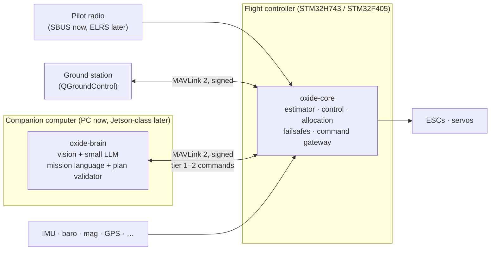

# Airborne Oxide — System Design

**Status:** Draft v0.1, awaiting owner sign-off · **Date:** 2026-11-04 · **Owner:** Daniel Biocchi

This document records every design decision made so far. No code is written until it is signed off.
After sign-off, changes are recorded as short decision records in `docs/adr/` and folded back in here.

Decision numbers (Q1–Q39) refer to the design interview. Each one is listed in [Appendix A](#appendix-a-decision-log).

---

## 1. What we are building

Airborne Oxide is flight software written in Rust. The name means "rust in the air". It has three parts, listed in order of importance:

1. **A simulator.** It has to be good enough to design both flight algorithms *and airframes*. It is deterministic, fast enough to fly thousands of test flights per commit, and calibrated against real flights.
2. **A flight core.** A small, verified, hard-real-time flight controller that can fly any airframe and stays safe whatever the AI does.
3. **An AI brain.** Computer vision plus a small on-board language model that makes mission decisions. Today it needs a companion computer. The design assumes it will move onto smaller drones as AI hardware shrinks.

The target is software lighter than ArduPilot, built around on-board AI from day one, and verified more rigorously than existing autopilots.

## 2. Principles

1. **The simulator is the flagship.** It gets the most effort. It should be the best open-source drone simulator for algorithm and airframe development, better than Gazebo for this job. (Q11, Q12)
2. **The flight core is the base.** It is deterministic, never allocates heap memory in the flight path, and never panics. It flies, and fails safe, with the brain dead or missing. (Q3, Q6)
3. **Numbers decide.** Our core earns its place by beating ArduPilot and PX4 in identical simulated scenarios. If it can't, ArduPilot flies the real drones and the effort goes into the simulator and brain. (Q9)
4. **The AI is untrusted input.** The brain proposes and the flight core enforces the limits. The pilot's radio outranks everything. (Q4, Q10)
5. **Build to scale, not build small.** The code is written to fit an STM32F405, and the STM32H7 build turns up rates, capacities and features rather than running a stretched-out small system. (Q13)
6. **Fly, calibrate, repeat.** We trust the simulator only after it matches real flight logs. (Q12, Q19)

## 3. System architecture

In simulation, `oxide-sim` takes the place of the hardware. It owns the clock, steps the *same* `oxide-core` code in lockstep, and feeds it simulated sensors. The same simulator can also fly ArduPilot SITL and PX4 SITL for benchmarking.

### Components (Q39)

| Crate | Role | Runs on |
|---|---|---|
| `oxide-core` | Flight core library: estimator, control laws, control allocation, failsafes, command gateway, parameters, logging. `no_std`, no heap, no framework. | MCU and host |
| `oxide-fw-h743`, `oxide-fw-f405` | Board firmware: the drivers plus RTIC 2 scheduling, wrapped around `oxide-core`. | MCU |
| `oxide-sim` | Simulator: physics, sensors, environment, faults, scenarios, SITL bridges, Python bindings. | PC / CI |
| `oxide-lab` | Airframe lab: airframe files, geometry, mass properties, aerodynamics pipeline, auto-tune, scorecards, optimizer. | PC |
| `oxide-brain` | Companion AI: perception, planner, mission language, plan validator. | PC now, companion later |

The simulator may get its own brand name before anything is published.

---

## 4. Flight core

### 4.1 Targets and build profiles (Q13)

| | F405 "lean" | H743 "full" |
|---|---|---|
| Role | Constrained target. CI must keep it building and within its size and timing budgets. | Main reference target |
| Rate loop | ~1–2 kHz | up to 4–8 kHz |
| IMUs / estimators | 1 IMU, 1 estimator | Several IMUs, each with its own estimator ("lanes"), cross-checked and voted |
| Filtering | Static notch + low-pass | FFT-based dynamic notch |
| Estimator precision | f32 | f32 or f64, whichever the simulator shows is worth it |

Both profiles build from the same source. The profile selects rates, capacities and features at compile time.

### 4.2 Runtime (Q14)

- `oxide-core` is a plain library of `step()` functions with explicit inputs and outputs. It has no framework and no global state.
- On the MCU, RTIC 2 provides preemptive priority-based scheduling, with resource sharing checked at compile time. Embassy's STM32 HAL provides the drivers.
- In the simulator, the same functions are called in lockstep. Determinism comes from the design itself, not from a runtime.

### 4.3 Numbers, units and frames (Q13)

- **Control laws:** `f32`.
- **Estimator:** generic over `f32`/`f64`. Both are generated from one symbolic derivation, and the build profile picks one.
- **Global position:** latitude and longitude as `f64` or as integer 1e-7 degrees (the MAVLink convention). Local position uses a North-East-Down (NED) frame near the origin.
- **Time:** integer microseconds. Time is never stored as a float.
- **Frames:** the world frame is NED and the body frame is Forward-Right-Down, the MAVLink / PX4 / ArduPilot convention.
- **Units:** SI everywhere. Each physical quantity has its own type, so the compiler rejects unit mix-ups.
- **Maths functions:** the `libm` crate on both host and MCU, so results match bit for bit.

### 4.4 Memory (Q13)

- The flight path never allocates on the heap. Buffers are sized at compile time with const generics, and the H743 profile simply sets larger sizes.
- Non-critical subsystems on large targets, such as mission upload, scripting and log upload, may use a heap. Flight-critical code never does.

### 4.5 Vehicle support (Q1, Q8)

- **Shared core:** estimator, safety, comms, logging, control allocation.
- **Control allocation:** constrained weighted least squares (`wls-alloc`, vendored, reviewed, with Kani proofs). Each vehicle class adds its own control-law module on top.
- **Order:** **Quad-X** → hex/octo (nearly free with allocation) → fixed-wing → tilt-rotor VTOL (the Titan Viper).

### 4.6 Control (Q17)

- **Baseline:** cascaded PID, running position → velocity → attitude (quaternion) → body rate.
- **INDI** (incremental nonlinear dynamic inversion) gets a slot at the rate/attitude level for disturbance rejection. The simulator's gust and fault scenarios compare it against PID. It works best with motor RPM feedback (bidirectional DShot).
- **MPC** comes later, for trajectory tracking.

### 4.7 State estimator (Q26)

- Our own error-state EKF, built on the architecture of PX4's EKF2 (BSD-3, credited). It predicts at IMU rate, fuses lagged sensors on a delayed time horizon, and gates innovations.
- The equations are derived symbolically (Python/SymPy) and emitted as generated Rust. The result can be audited and each function proven separately, and it is emitted as f32 or f64 from one source.
- PX4's EKF2 is the reference we benchmark against in the simulator.
- An invariant EKF will be tried later as a simulator experiment against ours.

### 4.8 Command authority (Q4, Q37)

Brain commands come in tiers. Every tier exists in the protocol from day one, and a configuration and safety policy decides which are enabled.

| Tier | Command | Typical rate | Status |
|---|---|---|---|
| 1 | Mission / intent ("survey this area", "land there") | ~0.1–1 Hz | Enabled |
| 2 | Trajectory: position / velocity / acceleration / yaw targets | 20–50 Hz | Enabled |
| 3 | Attitude + thrust | ~100 Hz | Disabled (future) |
| 4 | Body rates + thrust | ~100+ Hz | Disabled (future) |

The **command gateway** treats every brain message as untrusted. It:
- validates each command;
- clamps it to the flight limits (tilt, speed, altitude, geofence, terrain clearance);
- rejects stale commands;
- revokes the brain's authority after repeated violations.

The brain never controls the motors directly.

Autonomous patrol needs tiers 1–2 plus three things: a lost-link policy, missions that survive a brain reboot, and a watchdog on the brain. All three are flight-core features.

### 4.9 Command priority (Q10)

1. **Kill switch** on the radio. Motors stop, always.
2. **Pilot** (sticks and mode switch). Overrides everything below, including a failsafe already in progress.
3. **Flight-core safety:** failsafes and flight limits.
4. **Ground station.**
5. **Brain.**

### 4.10 Failsafe defaults, multirotor (Q28)

Every action is configurable, and the pilot can always override. The timings are starting values to be tuned in the simulator.

| Event | Default action |
|---|---|
| RC lost during manual flight | Hold position for 3 s, then return to launch |
| RC lost during an autonomous mission | Continue the mission (per-mission setting) |
| Ground station lost | Continue; return to launch if RC is also lost |
| Brain silent or commands stale (> 0.5 s) | Hold position; return to launch after 10 s |
| Brain command invalid or outside the limits | Reject or clamp it, log it and alert. After 3 strikes, revoke brain authority and hold. |
| Battery low | Warn and return to launch |
| Battery critical | Land immediately |
| GPS lost | Hold altitude with level attitude; land if GPS isn't back within 30 s |
| Estimator unhealthy | Switch estimator lane (H743). If no lane is healthy, land using attitude only. |
| Geofence breached | Return to launch |
| IMU failure | Switch IMU (H743). On the F405, land. |
| Motor failure | Hex/octo: land on the remaining motors. Quad: a controlled spinning descent (later, based on ETH Zurich research). |
| Excessive vibration | Warn, then land |

### 4.11 RC input (Q10, Q25)

- The RC receiver is wired straight to the flight core, never through the brain.
- **SBUS** is supported first, matching the FrSky X8R receivers and Taranis X9D+ 2019. **CRSF/ExpressLRS** comes second, as the planned upgrade for range.

### 4.12 Communications (Q5, Q9)

- MAVLink 2 through the `mavlink` crate, with our own dialect extending `common`.
- Message signing on the ground-station and brain links.
- QGroundControl works with it as a generic MAVLink autopilot: telemetry, map, missions and parameters. Calibration tools are our own.
- The brain uses standard offboard messages wherever possible, so it can also fly ArduPilot or PX4 vehicles.

### 4.13 Parameters (Q29)

- Each parameter is declared once in Rust, with its name, type, default, min/max, units and description.
- Parameters can be edited over MAVLink, so the QGroundControl parameter editor works. A metadata file for QGC is generated from the declarations.
- Parameters are stored in flash with a checksum and a schema version. Arming is refused if any parameter is out of range or the stored set is corrupt.
- Every change is logged. Parameter names are not ArduPilot-compatible.

### 4.14 Logging and replay (Q27)

- Logs use PX4's ULog format, which is open and self-describing and works with PlotJuggler and PX4 Flight Review.
- **Replay mode** logs every raw sensor sample, command and timestamp the core sees. That lets the simulator re-run any real flight through new code, bit for bit.

---

## 5. Simulator (`oxide-sim`), the flagship

### 5.1 Goals (Q11, Q20, Q21)

- **Deterministic:** the same seed gives a bit-identical flight, on Windows and on Linux.
- **Lockstep:** the simulator owns the clock and steps the exact `oxide-core` code that runs on the chip.
- **Fast:** the S1 quad runs at ≥ 100× real time on one core. Batch runs use every core, so CI can fly hundreds of randomized scenarios per commit.
- **Autopilot-agnostic:** it flies `oxide-core`, ArduPilot SITL (through its JSON external-physics interface) and PX4 SITL (through its simulator MAVLink interface). All three run the same scenarios and are graded on the same scorecard.
- **Scriptable:** Python bindings (PyO3) let it serve as a reinforcement-learning environment.
- **Pilot-in-the-loop:** you can fly it with the Taranis X9D+ as a USB joystick. OpenTX 2.3.15 supports joystick mode.

### 5.2 Physics

- `f64` throughout. Fixed-step RK4 integration at ≥ 1 kHz, independent of the flight core's loop rates.
- Collisions use `parry`/`rapier` in their bit-exact determinism mode (S2).

### 5.3 Phases (Q12)

| Phase | Adds |
|---|---|
| **S1** | **Vehicle physics:** 6-DOF rigid body; motor and prop dynamics (thrust ∝ ω², spin-up lag, battery voltage sag); body and rotor drag. **Environment:** wind (steady + gusts + turbulence). **Sensors:** IMU, baro, mag and GPS with noise, bias drift, latency and dropouts; timing jitter. **Fault injection:** motor loss, sensor failure, GPS loss or jamming, brain crash, link loss. **Tooling:** scenario files, Rerun viewer, joystick input, ArduPilot SITL bridge. |
| **S2** | **Physics:** vibration and IMU clipping/aliasing; ground effect; collisions. **Terrain:** built from real elevation data, plus an approximation of terrain-driven wind. **Sensors:** rangefinder and optical flow. **Tooling:** airframe lab A1, scorecards and auto-tune; Python bindings; system identification; PX4 SITL bridge. |
| **S3** | Rendered camera images through a renderer bridge; the brain in the loop; the generative airframe design loop |
| **S4** | Hardware-in-the-loop: the flight core runs on the real board while the simulator feeds it sensors over USB/UART |
| Ongoing | Calibration against real flight logs |

**Milestone 1 is S1 complete:** a quad that hovers and holds position in gusty wind and survives injected faults, in CI.

### 5.4 Scenarios

Scenarios are TOML files. Each one describes the vehicle, the environment (wind, terrain), the faults, the mission and the pass/fail criteria. CI runs every scenario across many random seeds.

### 5.5 Visualisation

Rerun provides 3D views and plots. It sits behind a thin internal layer because it is pre-1.0 and changes often.

### 5.6 Camera rendering (Q36)

We connect to an existing renderer rather than building one. The simulator stays the source of truth for physics and streams poses to the renderer. The candidates for S3 are:
- Project AirSim (Unreal Engine 5, MIT);
- Gazebo;
- a small renderer of our own for fast, low-detail depth images at reinforcement-learning scale.

A benchmark at S3 makes the choice. S1–S2 only define the interface.

### 5.7 Cross-checks (Q34)

CI compares our physics against independent references. A disagreement beyond tolerance fails the build until someone explains it.

- **Multirotor:** RotorPy, and Crazyflow (whose dynamics are fitted to real Crazyflie data).
- **Fixed-wing:** JSBSim, run as a separate process because of its LGPL license.
- **Autopilot behaviour:** ArduPilot and PX4 SITL.
- **A real aircraft:** the drag and power curves published in the Titan Viper manual.

### 5.8 Calibration pipeline (Q19)

- **S1:**
  - Import ArduPilot DataFlash `.bin` logs (ULog comes later).
  - Measure IMU noise (Allan variance) from logs recorded with the aircraft stationary, and feed the results into the sensor models.
  - Replay a real flight's commands through the simulator and plot sim against real.
- **S2:**
  - Fit motor and prop curves, drag and inertia to the logs (system identification, using arplaboratory's sysid methods as a reference).
  - Produce a sim-vs-real error report for every flight.
- **Extra data sources, in priority order:**
  1. Raw high-rate IMU logging
  2. ESC telemetry: RPM, current and voltage per motor
  3. A battery current sensor
  4. A thrust stand
  5. A bifilar pendulum, for inertia
  6. RTK GPS, as ground truth
  7. An airspeed sensor for the VTOL

---

## 6. Airframe lab (`oxide-lab`) (Q18, Q23, Q35)

The goal is to generate many airframes, fly them all in the simulator, score them, 3D-print the best, fly those for real, calibrate, and repeat.

- **Airframes are data files, not code.** Each file holds mass, inertia, geometry, motors and props (from a component library), battery, drag and control surfaces.
- **Geometry:**
  - **Generated designs:** the *parametric description* is the master copy. The aerodynamics come from it, and so does the STL mesh used for mass properties and for the printer.
  - **Imported designs** (such as the Viper): described parametrically from their published specs, with the design's own STL used for mass.
- **Mass properties** are computed from the mesh, the print recipe (material, infill, walls) and the placed components. Weighing and pendulum tests then correct them.
- **Aerodynamics** follow a fidelity ladder:

| Level | Method | Cost per design | Used for |
|---|---|---|---|
| A1 | AeroSandbox (vortex lattice) with NeuralFoil airfoils. Props from manufacturer data (APC) or blade-element theory (pyBEMT). | milliseconds–seconds | Screening thousands of designs |
| A2 | OpenVSP / VSPAERO panel method, run headless | seconds–minutes | Whole-body effects |
| A3 | SU2 / OpenFOAM CFD, offline | hours | Finalists; correcting A1 through cached tables |

  VTOL transition (prop wash, partly tilted rotors, flight near the stall) is the hardest regime to model. Calibration against real flights matters most there.
- **Scorecard:** maximum acceleration and climb, roll and yaw rate, turn radius, hover endurance, gust rejection, and survival after a motor failure. **Every airframe is auto-tuned before it is scored**, so we compare airframes rather than tuning.
- **Loop (S3):**
  1. A parametric generator proposes designs.
  2. Each design gets its mass and aerodynamics computed.
  3. The simulator auto-tunes it and scores it.
  4. An optimizer picks the next batch.
  5. Finalists go to A3, then get printed, flown and calibrated.
- **First validation test:** A1 must reproduce the Viper manual's curves. For example, stall is ≈ 11.5 m/s at 4.0 kg with C_Lmax 1.3 at sea level.
- **Phasing:**
  - **S1:** the file format, with Quad-X and the Viper as the first two airframes.
  - **S2:** mesh import, mass properties, A1, scorecard and auto-tune.
  - **S3:** the generator and optimizer.
  - **After S3:** A3.
- **Language:** the lab is offline tooling, so it may use Python through the simulator's bindings. The Rust simulator reads precomputed aerodynamics tables.
- **Third-party models:** they never go into the public repo. That includes Titan Dynamics' Viper STLs.

---

## 7. AI brain (`oxide-brain`) (Q4, Q22, Q37)

- **Layers:**
  - **Mission level:** the LLM makes about one decision per second. That matches a 2026 result of a vision-language model running on a Jetson Orin NX at a median of about 0.8 s.
  - **Reaction level:** vision and a local planner run at 20–50 Hz and send tier-2 targets.
  - **Limits:** the flight core enforces them.
- **Mission language:** the LLM never sends setpoints. It writes short plans built from verified skills such as `fly_to`, `scan_area`, `track`, `land_at` and `return_home`.
  - The brain validates every plan before running it: geofence, battery budget, terrain clearance and allowed skills.
  - Skills are ordinary tested code that issue tier 1–2 commands. The pattern comes from TypeFly and AerialClaw.
- **Compute budget:** the brain is developed on the owner's PCs but held to a target profile, so it is always tested at drone-realistic speed:
  - a few GB of memory;
  - a quantized model of roughly ≤ 4B parameters;
  - measured, plus injected, latency.

  Larger models are used only offline, for grading and labelling, never in the flight loop.
- **Development setup:** the simulator runs on the main PC (RTX 3080) and the brain on the networked AI PC (16 GB VRAM), talking over the LAN. That gives realistic link latency for free.
- **Middleware:** dora-rs, ROS 2 or copper-rs, chosen by benchmark at S3. Until then the brain is a small Rust program that speaks MAVLink.
- **Companion hardware:** chosen at S3, probably Jetson Orin Nano class. It will be carried on a 7" quad (Q2).

---

## 8. Relationship to ArduPilot and PX4 (Q5, Q9)

The strategy (option "c+" in the interview) is to build our own core and measure it.

- The simulator flies our core, ArduPilot SITL and PX4 SITL through identical scenarios and grades them on one scorecard: tracking error, gust rejection, fault recovery, and CPU and RAM use.
- **Benchmark gates** come at the end of S1 and S2. If our core can't match ArduPilot on what we care about and the gap can't be closed, ArduPilot becomes the flight base on real drones and the effort moves to the simulator and brain. Neither is wasted, because both work with all three autopilots.
- Meanwhile the Viper keeps flying ArduPilot as a source of real calibration data.
- **PX4 (BSD-3) is our code reference.** Its algorithms may be ported, with credit.
- **ArduPilot (GPL-3) is a behaviour reference only.** None of its code is copied.

---

## 9. Verification and quality (Q6)

- Unit tests and property-based tests (generated random inputs).
- Deterministic simulator scenarios in CI, run Monte-Carlo style across many seeds.
- **Kani proofs** on the critical pure logic:
  - control allocation and mixing;
  - saturation and clamping;
  - the failsafe state machine;
  - arming checks;
  - the command gateway.
- **Fuzzing** (`cargo-fuzz`) of every parser: MAVLink, GPS, RC, the brain link and log import.
- Lints in the flight crates that forbid heap allocation and panics.
- Exact replay of flight logs.
- CI-enforced code-size and timing budgets for the F405 profile.
- Flight-core dependencies are kept minimal, pinned and reviewed. The simulator and tools may be more liberal.

---

## 10. Licensing (Q16, Q31)

- **AGPL-3.0-or-later.** Anyone who ships or hosts a modified version must publish its source.
- **Dual licensing:** the owner keeps the right to sell closed-source commercial licenses. That requires a contributor license agreement (CLA), so the owner holds or can relicense every contribution. No external contributions are accepted until the CLA exists, and the CLA should be reviewed by a lawyer.
- **Dependency rule** (enforced by `cargo-deny` in CI):
  - Code linked into ours must have a permissive license: MIT, Apache-2.0, BSD, ISC, Zlib or similar.
  - GPL, LGPL and NOSA tools (AVL, XFOIL, OpenFOAM, JSBSim, OpenVSP, ArduPilot SITL) run only as separate processes. They are never linked or copied in.
  - PX4 algorithms may be ported, with credit. ArduPilot code is never copied.
- **Old code:** what was in this repository before 2026 was Apache-2.0 and stays so for anyone who has a copy. None of it is reused.

---

## 11. Hardware

### On hand

- **Titan Dynamics Viper:** a tri-tiltrotor VTOL with a 1.6 m span, on a Matek **F405-WTE**, running ArduPilot. Its setup review is in [`docs/hardware/viper.md`](hardware/viper.md).
- **Flight controllers:** a bench board (the Matek F405 from the original project) and a second F405-WTE.
- **Radio:** FrSky **Taranis X9D+ 2019** (OpenTX 2.3.15) and two FrSky **X8R** receivers (SBUS).
- **GPS:** Beitian BN-880Q (M8, QMC5883L compass) and BK-880Q (M9, with compass).
- **Motors:** 1× iFlight XING-E 2207 1800KV (a 6S 5" motor) and 1× SunnySky X2212.
- **Other:** Walksnail Avatar HD kit, HOTA S6 charger, 4S 4000 mAh and 6S 1500 mAh packs.
- ⚠️ **The Hobbywing Skywalker 30A ESC is rated for 2–3S. Never connect it to the 6S pack.**

### Purchase timeline (Q30)

| When | What | Approx. cost |
|---|---|---|
| Now | Nothing. S1 is pure simulation. | — |
| When H7 chip work starts | An H743 flight controller (e.g. Matek H743-SLIM V3; check the specs before buying) and an SWD debug probe (e.g. ST-Link V3 Mini) | C$80–110 + C$20–40 |
| When the core passes S1 | A 5" 6S test quad: 3× XING-E 2207 1800KV, frame, props, and a 4-in-1 ESC with RPM telemetry running AM32 firmware. Reuses an X8R, the GPS and the 6S pack. | C$250–350 |
| S3 | A 7" quad and the companion computer (Jetson class) | TBD |
| Any time | DIY thrust stand (load cell + HX711 + Arduino); an airspeed sensor for the Viper; an ELRS module and receivers | ~C$30; TBD; C$80–120 |

---

## 12. Development environment and workflow (Q15, Q38)

- **Machines:**
  - A Windows 11 PC (B550M, 32 GB RAM, RTX 3080 10 GB).
  - A networked AI PC (16 GB VRAM, 16 GB RAM).

  Windows and Linux are both fully supported platforms, and CI runs on Linux.
- **Rust:** stable, edition 2024, with strict lints in the flight crates.
- **Workflow:**
  1. This document lands on a fresh-history branch for sign-off.
  2. On sign-off, the old `main` is tagged `legacy` and `main` is replaced with the new history.
  3. From then on, each piece of work is a branch with a pull request into `main`. CI must pass, and the owner merges.
- **CI (GitHub Actions):**
  - **Every pull request:** build, tests, lints and `cargo-deny`.
  - **Nightly:** Kani, fuzzing and Monte-Carlo runs.
- **Visibility:** the repository stays public.
- **After sign-off:** design changes are recorded as short decision records in `docs/adr/`.

---

## 13. Roadmap

| Milestone | Contents | Done when |
|---|---|---|
| **M0** | This design; repository reset | The owner signs off |
| **M1 (S1)** | Cargo workspace and CI; `oxide-sim` S1; the `oxide-core` quad baseline (estimator, cascaded PID, allocation, failsafes, parameters, ULog) running in lockstep; ArduPilot SITL bridge; flying with the joystick | A quad hovers and holds position in gusty wind and survives injected faults, in CI. **Benchmark gate 1.** |
| M1, in parallel | F405 bring-up on the bench board: drivers for IMU, baro, PWM/DShot, UART and SBUS | Real sensor data flowing through `oxide-core` on the F405 |
| **M2 (S2)** | S2 fidelity; airframe lab A1, scorecard and auto-tune; Python bindings; system identification; PX4 bridge; H743 bring-up | The Viper's curves are reproduced, and there's a sim-vs-real report on real logs. **Benchmark gate 2.** |
| **M3 (S3)** | Renderer bridge; brain in the loop; generative design loop | The brain completes a simulated mission within its compute budget |
| **M4 (S4)** | Hardware-in-the-loop; first real quad flights | Real flights match the simulator within tolerance |

There are no dates. Each milestone ends when its "done when" condition is met.

---

## 14. Open and deferred items

| Item | When |
|---|---|
| Viper data (Q24): every SD-card log; a props-off bench log (`LOG_DISARMED=1`, 30+ min); motor, prop, battery and ESC models; all-up weight | When the S1 sensor models need real noise data |
| Fixing the Viper's setup | The owner decides when; see `docs/hardware/viper.md` |
| The bench board's exact model and sensors | At F405 bring-up |
| The exact H743 board | Before buying |
| Brain middleware, renderer, companion computer | S3 |
| A brand name for the simulator | Before publishing crates |
| The CLA text (with lawyer review) | Before accepting external contributions |
| The ELRS upgrade | The owner decides when |

Prior-art survey: [`docs/research/prior-art-2026-11.md`](research/prior-art-2026-11.md).

---

## Appendix A: Decision log

| # | Decision |
|---|---|
| Q1 | Vehicle-agnostic core with a control-allocation layer |
| Q2 | Reference size is mid (5–7", ~0.6–1.5 kg); the core stays portable to tiny boards |
| Q3 | Two tiers: an MCU flight core and a Linux companion brain |
| Q4 | Layered AI authority in four tiers; tiers 1–2 enabled; can be expanded later |
| Q5 | MAVLink 2; no ArduPilot parameter or mode compatibility |
| Q6 | Verification: tests, deterministic simulator CI, Kani, fuzzing, no heap and no panics, replay |
| Q7 | Simulator first |
| Q8 | Quad-X first, then hex/octo, fixed-wing and tilt-rotor VTOL |
| Q9 | Strategy c+: our own core, benchmarked against ArduPilot and PX4 at set gates |
| Q10 | Command priority: kill switch > pilot > core safety > ground station > brain |
| Q11 | Our own simulator, as the flagship |
| Q12 | Simulator phases S1–S4. Trustworthy means deterministic, complete, and validated against real logs |
| Q13 | H743 is the main target and F405 the lean target; f32 control, f32/f64 estimator; no heap in the flight path |
| Q14 | RTIC 2 plus Embassy drivers; the core has no framework |
| Q15 | Development machines as listed in §12 |
| Q16 | AGPL-3.0-or-later with a CLA and dual licensing; fresh history; `legacy` tag |
| Q17 | Cascaded PID baseline, a slot for INDI, MPC later |
| Q18 | Airframe lab, with auto-tune before scoring |
| Q19 | Calibration pipeline; the Viper (tri-tiltrotor, F405-WTE, ArduPilot) is the first real data source |
| Q20 | Pilot in the loop, with the Taranis as a USB joystick |
| Q21 | Python bindings for reinforcement learning (S2) |
| Q22 | The brain is held to a drone-realistic compute budget (a few GB) |
| Q23 | Geometry from parametric or mesh files; aerodynamics fidelity ladder A1–A3 |
| Q24 | *Deferred:* collecting the Viper's data |
| Q25 | SBUS first, CRSF/ELRS second |
| Q26 | Our own error-state EKF on PX4 EKF2's architecture, derived symbolically and emitted as generated Rust |
| Q27 | ULog with a replay mode; the simulator reads ULog and DataFlash |
| Q28 | The failsafe defaults table (§4.10) |
| Q29 | Typed parameters over MAVLink, checksummed, with arming refused on bad values |
| Q30 | Purchase timeline (§11) |
| Q31 | Dependency license rule, enforced by `cargo-deny` |
| Q32 | The core doesn't depend on copper-rs or stable-flight; we borrow their ideas |
| Q33 | Building blocks: `mavlink`, RTIC 2, Embassy, `wls-alloc`, `nalgebra`, `rapier`/`parry`, PyO3, Rerun |
| Q34 | Physics cross-checks in CI |
| Q35 | Airframe lab aerodynamics start with AeroSandbox + NeuralFoil (Python), feeding tables to the Rust simulator |
| Q36 | Camera rendering: connect to an existing renderer, chosen at S3 |
| Q37 | The LLM writes plans in a verified mission language; middleware chosen at S3 |
| Q38 | Workflow: sign-off, then reset `main`, then a pull request per change; the repo stays public |
| Q39 | `oxide-*` component names |
