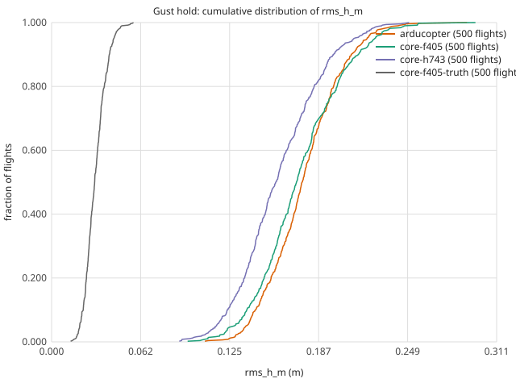
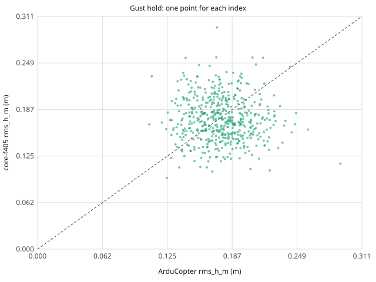

# Benchmark gate 1: our flight core against ArduCopter

**Verdict: NOT PASSED.** Flown once, on 18 November 2026, at commit `2c2fedb`.

One criterion of five did not hold: **A2**, the comparison of position hold in gusts. Our core's median error is lower than ArduCopter's, but its 95th percentile is higher, and A2 asks for both.

| | Our core (F405) | ArduCopter | |
|---|---|---|---|
| Position error in gusts, median of 500 runs | 0.1714 m | 0.1754 m | ours 2.3 % lower |
| Position error in gusts, 95th percentile | **0.2261 m** | **0.2209 m** | **ours 2.4 % higher: fails** |
| Gust flights that are not safe | 0 of 500 | 0 of 500 | |
| Failure flights that end in a crash or a fly-away (38 scenarios, 10 runs each) | 0 of 380 | 60 of 380 | |
| Motors off after a lost motor, median | 1.0 s | never | |
| Motors off after a lost IMU, median | 0.14 s | 2.0 s | |

By ADR-0007 §7 the criteria stay as they are. The core is improved and the whole gate is flown again.

This is the report that ADR-0007 §8 asks for. The criteria were fixed in that record before the gate was flown and are not repeated in full here. The program that flew the gate and computed the verdict is `oxide-bridge gate` (`crates/oxide-bridge/src/gate/`); its own report, written from the tables with no hand in between, is [`gate-1.md`](gate-1.md).

## What was compared

| | |
|---|---|
| Vehicle | the reference quad, `airframes/quad-x-5in.toml`, in our simulator (`oxide-sim`) |
| Our core | commit `2c2fedb`, with the parameters that commit ships. The F405 profile (1 kHz) decides; the H743 profile (4 kHz) is reported and must also meet A1 |
| ArduCopter | V4.7.2, the released SITL binary (SHA-256 `caed35e4cb796ec06cac40b09566a18251771486b1cbac5e2bf16b7a5ed5045d`), run as a separate program over sockets at a 500 µs step, on its own estimator (EKF3). No ArduPilot code or binary is in this repository |
| ArduCopter's parameters | `crates/oxide-bridge/arducopter/`: `base.parm`, `setup.parm`, `tuned-gains.parm`, `failsafes.parm`, in that order, then the two battery thresholds and, for a scenario with a fence, the fence |
| Flights | 3,253 in all. Gusts: `gust-hold` runs 0 to 499, flown by ArduCopter, by our core on both profiles, and by our F405 core on the true state. Failures: every other scenario file on the runs it names (38 scored on the outcome, 2 on the time to motors off, 2 not scored: 411 flights for each of the three). Ten ArduCopter flights were flown twice more, to check that they repeat. All 921 ArduCopter flights of the tables started at the first try |

**How ArduCopter was tuned** (ADR-0007 §2): the settings of ArduPilot's tuning guide for a 5-inch propeller and six cells, then one scripted flight in calm air: hover and learn the hover thrust, take a gyro spectrum (no peak, so no notch), run its automatic tuner on roll, pitch and yaw to success, land so that it saves its gains. The script is `oxide-bridge tune`; what it printed is in [`tuning-report.txt`](tuning-report.txt), and the file it wrote is flown exactly as written. A second run writes the same file byte for byte.

**Our core was not tuned for the gate.** Its gains were set by hand during development, on this airframe, in this simulator.

## The verdict, criterion by criterion

| Criterion | | What was measured |
|---|---|---|
| **A1.** Every one of our core's 500 gust flights is safe and passes the scenario file's limits | holds | 500 of 500 on the F405 profile and 500 of 500 on the H743 profile |
| **A2.** Our core's median position error and its 95th percentile are each at most ArduCopter's | **fails** | median 0.17141 m against 0.17545 m (holds); 95th percentile 0.22612 m against 0.22087 m (fails) |
| **B1.** In no scenario scored on its outcome does our core end more flights in a crash or a fly-away than ArduCopter | holds | ours 0 in all 38 scenarios; ArduCopter 10 of 10 in six scenarios and 0 in the others |
| **B2.** Our core has no crash and no fly-away in those scenarios, and every flight passes its file's own expectations | holds | 380 of 380 |
| **B3.** In `motor-loss` and `imu-loss` our core's median time to motors off is at most ArduCopter's | holds | 0.999 s against 14.9995 s (its motors never stop); 0.139 s against 2.0015 s |
| The ten flights flown twice repeat bit for bit | holds | 10 of 10, and each equals its row in the tables |

## Criterion A: holding position in gusts

RMS of the horizontal distance from the hold point, from 15 s to the end of each 40 s flight, in metres. All 2,000 flights are safe.

| | Median | 95th percentile | Mean | Worst | Better than ArduCopter in |
|---|---|---|---|---|---|
| ArduCopter | 0.1754 | 0.2209 | 0.1765 | 0.2907 | |
| Our core, F405 profile (decides) | 0.1714 | 0.2261 | 0.1738 | 0.2966 | 266 of 500 runs |
| Our core, H743 profile (reported) | 0.1570 | 0.2116 | 0.1593 | 0.2502 | 329 of 500 runs |
| Our F405 core on the true state (reported) | 0.0301 | 0.0435 | 0.0308 | 0.0573 | |

What the numbers say:

- **Our F405 core is better in the middle and worse at the edge.** It has the lower error in 266 of the 500 runs and the lower median, but its errors are spread wider (a standard deviation across runs of 0.030 m against 0.026 m), so its worst twentieth is worse. In the first figure its curve lies left of ArduCopter's up to about the 75th flight in a hundred and to the right above that: 8 mm better at the best twentieth, 4 mm better at the median, 5 mm worse at the 90th, 95th and 99th.
- **This is not one unlucky block of seeds.** Taken a hundred runs at a time, our 95th percentile is above ArduCopter's in four of the five hundreds (0.2250 against 0.2182, 0.2245 against 0.2217, 0.2292 against 0.2142, 0.2218 against 0.2181) and level in the first (0.2211 against 0.2212). The first hundred is the one the first looks of ADR-0007 were flown on, which is why they looked level.
- **The error is the estimate, not the control.** On the true state the same core holds position within 0.030 m at the median, against 0.171 m on its own estimate: nearly all of the error comes from what the estimator makes of the GPS, whose error is 0.3 m per axis for both autopilots.
- **Our H743 profile would have met A2** (0.1570 m and 0.2116 m, both below ArduCopter's). The F405 profile decides because a bridged flight has the F405 flight's wind, sample for sample; the H743's flights have other wind samples of the same statistics. Why the 4 kHz profile holds 8 % tighter at the median (6 % at the 95th percentile) than the 1 kHz one is the first question for the improvement.
- The two autopilots' errors on the same seed are unrelated (correlation −0.05; second figure): which runs are hard is decided by each one's own answer to the GPS noise, not by the wind they share.
- Reported and deciding nothing: ArduCopter's vertical error is larger (median 0.093 m against our 0.063 m) and its tilt smaller (median 6.7° against 9.4°).





## Criterion B: failures

Each scenario was flown on the ten runs its file names. Classes are from the true state, by the same code for both (ADR-0007 §4).

- **Our core:** in the 38 scenarios scored on their outcome, all 380 flights on the F405 profile are safe and pass their files' own expectations, and so are all 380 on the H743 profile.
- **ArduCopter:** 320 of its 380 are safe. The other 60 are all ten runs of six of the seven scenarios with a barometer loss (in the seventh, `pair-rc-loss+baro-loss`, its radio failsafe brings it down at 1.7 m/s, under the crash limit). With every barometer gone it has no failsafe and climbs without limit: a fly-away in `baro-loss` and in the pairs with a low battery, a brain crash and a geofence, and a crash in the pairs with a critical battery and a GPS loss, where it does come down, at 3.0 and 2.6 m/s.
- **Motors off** (`motor-loss`, `imu-loss`; a quadrotor cannot fly on with either, so both autopilots' flights are crashes and the score is how soon the motors stop): our core stops them 1.0 s after a lost motor and 0.14 s after a lost IMU. ArduCopter never stops them after a lost motor (they are still commanded when the flight ends, 15 s later) and stops them 2.0 s after a lost IMU.
- `kill-in-rtl` is not scored (a kill switch at 10 to 15 m is a crash for both, as it must be), and `hover-step` has no failure and was flown as a check of the bridge.

The per-scenario table in [`gate-1.md`](gate-1.md) gives the touchdown speed, the distance of the end position from the arming point, the greatest tilt and the time of the disarm for every scenario and autopilot. Our core lands faster than ArduCopter (about 0.7 m/s against 0.5 m/s) and tilts further when it flies a long way back (to its limit of 35°, where ArduCopter tilts to 20 or 21°); neither comes near a limit of the outcome class.

## What could not be made equal, and which way each leans

Both autopilots fly the same vehicle in the same wind, read the same IMU samples and the same horizontal GPS error, and are classed by the same code from the true state. These differences remain:

| Difference | Leans towards |
|---|---|
| **Tuning.** ArduCopter's attitude gains come from its own automatic tuner and its position controller is at its defaults, as its standard procedure leaves it. Our core's gains, position loop included, were set by hand on this airframe in this simulator | us |
| **The simulator is ours.** Our core was developed against these physics and these sensor models; ArduCopter met them for the first time | us |
| **Height sensing.** ArduCopter's simulated GPS height error is a slow sine of 0.21 m where ours is random with 0.5 m; our barometer has a start-up offset and a slow drift and ArduCopter's simulated one has neither | ArduCopter (the vertical error decides nothing) |
| **Battery sensing.** Our battery sensor has noise; ArduCopter reads the pack's voltage and current as they are | ArduCopter, slightly |
| **Computation delay.** ArduCopter's commands take effect in the step they are computed in; our core's one tick later (at most 1 ms) | ArduCopter, slightly |
| **Barometer and compass noise.** ArduCopter's is the same sequence in every flight, so its flights vary by wind, IMU noise and GPS error only | neither on average; its spread across runs is a little narrower than it would be |
| **Expectations.** Our core must also pass each scenario file's own, stricter expectations (B2); ArduCopter is scored on the outcome class alone | ArduCopter |
| **The pilot's sticks.** The same stick script is flown by both without scaling, and for the same roll or pitch stick ArduCopter flies 1.65 to 1.8 times as far (measured one stick at a time, ADR-0007 §6). In the gate's flights where the pilot flies it out (`rc-loss-position`, `rc-loss-override`) it went about 1.6 times as far, and at the failure in `rc-loss-position` it was 24.9 m out against our 14.1 m | us, slightly (it is scored on the class only, and both stay far inside the limits) |
| **The start of a gust flight.** ArduCopter keeps its motors still for 2.0 s after arming and is at the hold point at about 8.7 s, our core at 5.3 s. The error is measured from 15 s | neither |
| **Failsafe timers.** The battery thresholds are set so that both act at the same state of the pack; each keeps its own timer (ArduCopter 10 s, ours about 4 s) | neither: it is each one's own design |

What a pass says, and what it does not (ADR-0007, Consequences): a pass says that our core, as it is, holds position in gusts at least as well as a tuned ArduCopter on equal sensors, and never ends a failure worse. It does not say that our tuning method is as good as ArduCopter's, which was not compared, and the outcome classes are coarse on purpose: they cannot say which autopilot chose the wiser response, only that neither response ended badly.

## How to fly it again

Every flight repeats bit for bit, so anyone can check the tables. With the released ArduCopter 4.7.2 SITL binary (the program refuses any other checksum):

```bash
git checkout 2c2fedb1dab3c65f8d52a431b38b369e9ffa4091
```

```bash
cargo build --release --locked -p oxide-bridge
```

```bash
target/release/oxide-bridge gate fly --scenarios scenarios --out /tmp/gate1 --binary /path/to/arducopter --jobs 3
```

```bash
target/release/oxide-bridge gate verdict --in /tmp/gate1 --report /tmp/gate1-report/gate-1.md
```

The hashes in the tables it writes must equal the ones in [`tables/`](tables/). The flight took 27 minutes on four cores, three flights at a time; nearly all of that is ArduCopter's 931 flights.

## Files here

| File | What it is |
|---|---|
| [`gate-1.md`](gate-1.md), `gate-1-cumulative.svg`, `gate-1-scatter.svg` | the program's own report and figures, as written |
| [`gate.txt`](gate.txt) | what was flown: the commit, the plan, the checksums of the binary, of every scenario file and of every parameter file |
| [`verdict.txt`](verdict.txt) | what `gate verdict` printed |
| [`tables/`](tables/) | every flight's row: seed, class, measures, hashes. One file for each scenario and autopilot, and the ten flights flown twice |
| [`tuning-report.txt`](tuning-report.txt) | what the tuning script printed for the flight that wrote `tuned-gains.parm` |

Each flight's own record (`audit.txt`, with everything sent to ArduCopter and its status texts and mode changes) is not committed: there are 3,253 of them. Flying the gate again writes them.
