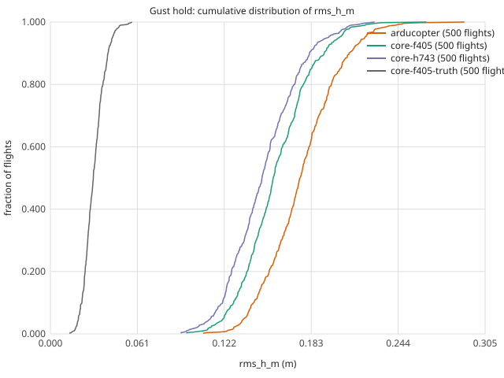
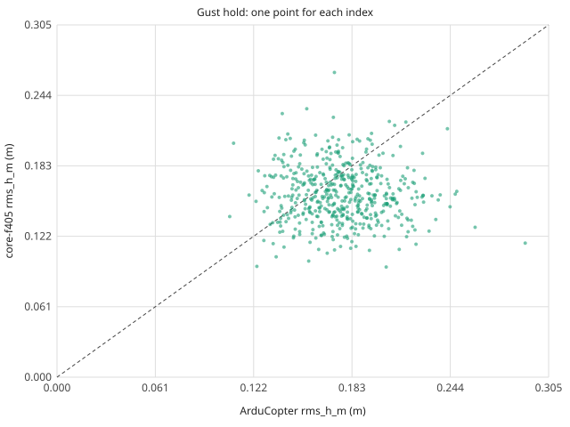

# Benchmark gate 1, second run: passed

**Verdict: PASSED.** Flown on 19 November 2026 at commit `92fdaa2`, with the criteria of [ADR-0007](../../../adr/0007-gate-1-criteria.md) unchanged.

| | Our core (F405) | ArduCopter | |
|---|---|---|---|
| Position error in gusts, median of 500 runs | 0.1566 m | 0.1754 m | ours 10.8 % lower |
| Position error in gusts, 95th percentile | 0.2028 m | 0.2209 m | ours 8.2 % lower |
| Gust flights that are not safe | 0 of 500 | 0 of 500 | |
| Failure flights that end in a crash or a fly-away (38 scenarios, 10 runs each) | 0 of 380 | 60 of 380 | |
| Motors off after a lost motor, median | 1.0 s | never | |
| Motors off after a lost IMU, median | 0.14 s | 2.0 s | |
| The ten flights flown twice repeat bit for bit | 10 of 10 | | |

The [first run](../README.md), at commit `2c2fedb` on 18 November, was not passed: A2 failed on the 95th percentile (0.2261 m against 0.2209 m). The criteria then stayed as they were. The core was improved, and the whole gate was flown again on the improved core. The program's own report of this run, written from the tables with no hand in between, is [`gate-1.md`](gate-1.md).

## What changed between the two runs

One change to our core, and nothing else: the estimator's process noise is now applied per second rather than per filter step ([ADR-0002](../../../adr/0002-estimator.md) item 12, commit `c8aa714`, [PR #7](https://github.com/danbiocchi/airborne-oxide/pull/7)).

The four process-noise parameters carry PX4 EKF2's default values. PX4 applies them per 10 ms prediction step, and our filter applied them per 4 ms step, so it assumed 0.4 of PX4's noise per second. The fix keeps PX4's values and their meaning at any filter rate.

The change was found and judged under the two rules ADR-0007 set after the first run:

- **It was found on other seeds.** The diagnosis that found it flew gust-hold runs 500 to 999 and the other scenario files on runs 500 to 519. Nothing was chosen or judged on the gate's runs 0 to 499; run 0 of each file was flown only to re-pin its trace hash, as every change to the core does. On runs 500 to 999 it moved our F405 core from 0.1707 / 0.2302 m (median / 95th percentile) to 0.1574 / 0.2009 m, against ArduCopter's 0.1747 / 0.2137 m there.
- **It stands on its own grounds:** PX4's meaning of the parameters, and a filter that behaves the same at every rate DESIGN allows. An independent check found that it does not make the filter's own uncertainty more truthful: the filter stays underconfident, because it assumes more measurement noise than the simulator has. ADR-0002 says so.

ArduCopter, its parameter files, the bridge, the scenario files, the binary and the criteria are the same as in the first run. All 921 ArduCopter rows of the tables (911 flights and the 10 repeats) equal the first run's in every column but the wall-clock time, and so do the 500 rows of our core on the true state.

## The verdict, criterion by criterion

| Criterion | | What was measured |
|---|---|---|
| **A1.** Every one of our core's 500 gust flights is safe and passes the scenario file's limits | holds | 500 of 500 on the F405 profile and 500 of 500 on the H743 profile |
| **A2.** Our core's median position error and its 95th percentile are each at most ArduCopter's | holds | median 0.15658 m against 0.17545 m; 95th percentile 0.20278 m against 0.22087 m |
| **B1.** In no scenario scored on its outcome does our core end more flights in a crash or a fly-away than ArduCopter | holds | ours 0 in all 38 scenarios; ArduCopter 10 of 10 in six of the seven with a barometer loss, 0 in the others |
| **B2.** Our core has no crash and no fly-away in those scenarios, and every flight passes its file's own expectations | holds | 380 of 380 |
| **B3.** In `motor-loss` and `imu-loss` our core's median time to motors off is at most ArduCopter's | holds | 0.999 s against 14.9995 s (its motors never stop); 0.139 s against 2.0015 s |
| The ten flights flown twice repeat bit for bit | holds | 10 of 10, and each equals its row in the tables |

A second implementation of the verdict, written from ADR-0007 alone during the review of the verdict program, gives the same six results on these tables, with the same numbers to the last bit.

## Criterion A: holding position in gusts

RMS of the horizontal distance from the hold point, from 15 s to the end of each 40 s flight, in metres. All 2,000 flights are safe.

| | Median | 95th percentile | Mean | Worst | Better than ArduCopter in |
|---|---|---|---|---|---|
| ArduCopter | 0.1754 | 0.2209 | 0.1765 | 0.2907 | |
| Our core, F405 profile (decides) | 0.1566 | 0.2028 | 0.1587 | 0.2641 | 350 of 500 runs |
| Our core, H743 profile (reported) | 0.1486 | 0.1948 | 0.1500 | 0.2277 | |
| Our F405 core on the true state (reported) | 0.0301 | 0.0435 | 0.0308 | 0.0573 | |

- **Our F405 core is now lower at every point of the distribution,** not only in the middle. Its curve lies left of ArduCopter's at every percentile from the 1st to the 99th: 15 mm lower at the 5th, 19 mm at the median, 17 mm at the 90th, 18 mm at the 95th and 21 mm at the 99th. In the first run it was 4 mm lower at the median and 5 mm higher at the 95th.
- **By hundreds of runs** our 95th percentile is below ArduCopter's in all five (0.2000 against 0.2212, 0.1960 against 0.2182, 0.1975 against 0.2217, 0.2069 against 0.2142, 0.1992 against 0.2181). In the first run it was above in four of the five.
- **The spread across runs** narrowed: a standard deviation of 0.025 m, against 0.030 m in the first run and ArduCopter's 0.026 m.
- **Most of the error is still the estimate.** On the true state the same core holds about 0.030 m at the median.
- Reported and deciding nothing: our vertical error is smaller than ArduCopter's (median 0.057 m against 0.093 m) and our tilt larger (median 9.4° against 6.7°), as in the first run.





## Criterion B: failures

The failure flights tell the same story as in the first run; no class or verdict of our core changed in any of them.

- **Our core:** all 380 flights of the scenarios scored on their outcome are safe and pass their files' own expectations, on both profiles.
- **ArduCopter:** 320 of its 380 are safe, as in the first run. The other 60 are all ten runs of six of the seven scenarios with a barometer loss: with every barometer gone it climbs without limit or comes down too fast.
- **Motors off:** our core stops them 1.0 s after a lost motor and 0.14 s after a lost IMU, as before. ArduCopter never stops them after a lost motor and stops them 2.0 s after a lost IMU.

The per-scenario table in [`gate-1.md`](gate-1.md) gives the touchdown speed, the end distance from the arming point, the greatest tilt and the time of the disarm for every scenario and autopilot.

## What a pass says, and what it does not

ADR-0007, Consequences:

- **What it says:** our core, as it is, holds position in gusts at least as well as a tuned ArduCopter on equal sensors, and never ends a failure worse.
- **What it does not say:** that our tuning method is as good as ArduCopter's, which was not compared.
- **What the classes cannot show:** the outcome classes are coarse on purpose. They cannot say which autopilot chose the wiser response, only that neither response ended badly.

What could not be made equal between the two, and which way each difference leans, is unchanged from the first run and listed in [its report](../README.md#what-could-not-be-made-equal-and-which-way-each-leans).

Two things about this pass need saying:

- **The gate was flown twice, and the second run passed.** The change between them was chosen on seeds the gate does not fly, and it passed there too before the gate was flown again. The second run measured the improved core on the same 500 winds, so its pass is not a fit to them. The first run stays in the record.
- **The fix does not mean the estimator is now well calibrated.** The independent consistency check found three faults outside this change, deferred in ADR-0002:
  - a slow pitch and accelerometer-bias drift through the heading fusion in flights of minutes, which must be fixed before flight on hardware;
  - the barometer's drift, which the filter does not model;
  - the simulated GPS, which reports twice its true noise.

## How to fly it again

With the released ArduCopter 4.7.2 SITL binary (the program refuses any other checksum):

```bash
git checkout 92fdaa22a7b9c8e1fec3e93b42b32120e7334c1c
```

```bash
cargo build --release --locked -p oxide-bridge
```

```bash
target/release/oxide-bridge gate fly --scenarios scenarios --out /tmp/gate1 --binary /path/to/arducopter --jobs 3
```

```bash
target/release/oxide-bridge gate verdict --in /tmp/gate1 --report /tmp/gate1-report/gate-1.md
```

The hashes in the tables it writes must equal the ones in [`tables/`](tables/). This run took 32 minutes on four cores, three flights at a time.

## Files here

| File | What it is |
|---|---|
| [`gate-1.md`](gate-1.md), `gate-1-cumulative.svg`, `gate-1-scatter.svg` | the program's own report and figures, as written |
| [`gate.txt`](gate.txt) | what was flown: the commit, the plan, the checksums of the binary, of every scenario file and of every parameter file |
| [`verdict.txt`](verdict.txt) | what `gate verdict` printed (the paths in it and in `gate.txt` are those of the machine the gate was flown on) |
| [`tables/`](tables/) | every flight's row: one file for each scenario and autopilot, and the ten flights flown twice |

ArduCopter's tuning report is the first run's ([`../tuning-report.txt`](../tuning-report.txt)): its parameter files did not change. Each flight's own record (`audit.txt`) is not committed; flying the gate again writes them.
