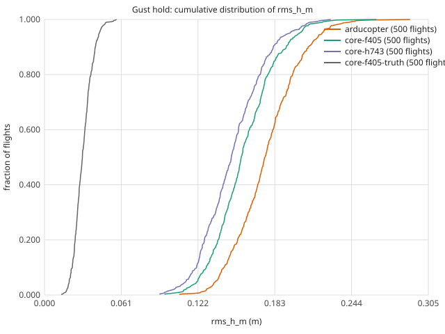
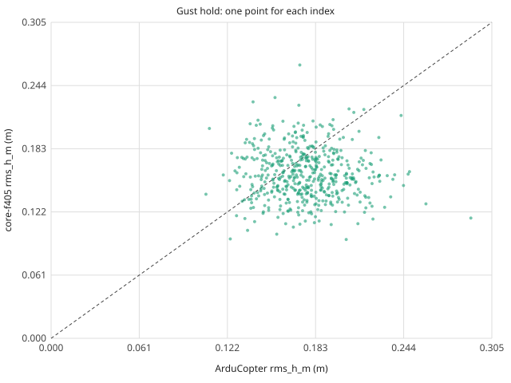

# Gate 1 report

**Verdict: PASSED**

Commit `92fdaa22a7b9c8e1fec3e93b42b32120e7334c1c`, clean tree.

## The criteria

### A1: HOLDS

- core-f405: 500 of 500 flights are safe and pass the scenario file's limits
- core-h743: 500 of 500 flights are safe and pass the scenario file's limits

### A2: HOLDS

- ArduCopter: 0 of 500 flights are not safe and are left out of its statistics
- median: core-f405 0.1565784371142276 m, ArduCopter 0.1754460832792722 m (ours at most theirs)
- 95th percentile: core-f405 0.20278113671598863 m, ArduCopter 0.2208698311507864 m (ours at most theirs)

### B1: HOLDS

- gps-loss: core-f405 0 crash or fly-away, ArduCopter 0
- gps-loss-pilot: core-f405 0 crash or fly-away, ArduCopter 0
- gps-loss-recovers: core-f405 0 crash or fly-away, ArduCopter 0
- baro-loss: core-f405 0 crash or fly-away, ArduCopter 10
- mag-loss: core-f405 0 crash or fly-away, ArduCopter 0
- rc-loss-position: core-f405 0 crash or fly-away, ArduCopter 0
- rc-loss-override: core-f405 0 crash or fly-away, ArduCopter 0
- rc-loss-on-ground: core-f405 0 crash or fly-away, ArduCopter 0
- rc-loss-offboard-gcs: core-f405 0 crash or fly-away, ArduCopter 0
- gcs-loss: core-f405 0 crash or fly-away, ArduCopter 0
- no-human-link: core-f405 0 crash or fly-away, ArduCopter 0
- battery-low: core-f405 0 crash or fly-away, ArduCopter 0
- battery-critical: core-f405 0 crash or fly-away, ArduCopter 0
- geofence: core-f405 0 crash or fly-away, ArduCopter 0
- brain-crash: core-f405 0 crash or fly-away, ArduCopter 0
- brain-hang: core-f405 0 crash or fly-away, ArduCopter 0
- setpoint-gap: core-f405 0 crash or fly-away, ArduCopter 0
- pair-battery-critical+baro-loss: core-f405 0 crash or fly-away, ArduCopter 10
- pair-battery-critical+brain-crash: core-f405 0 crash or fly-away, ArduCopter 0
- pair-battery-critical+geofence: core-f405 0 crash or fly-away, ArduCopter 0
- pair-battery-low+baro-loss: core-f405 0 crash or fly-away, ArduCopter 10
- pair-battery-low+battery-critical: core-f405 0 crash or fly-away, ArduCopter 0
- pair-battery-low+brain-crash: core-f405 0 crash or fly-away, ArduCopter 0
- pair-battery-low+geofence: core-f405 0 crash or fly-away, ArduCopter 0
- pair-brain-crash+baro-loss: core-f405 0 crash or fly-away, ArduCopter 10
- pair-brain-crash+geofence: core-f405 0 crash or fly-away, ArduCopter 0
- pair-geofence+baro-loss: core-f405 0 crash or fly-away, ArduCopter 10
- pair-gps-loss+baro-loss: core-f405 0 crash or fly-away, ArduCopter 10
- pair-gps-loss+battery-critical: core-f405 0 crash or fly-away, ArduCopter 0
- pair-gps-loss+battery-low: core-f405 0 crash or fly-away, ArduCopter 0
- pair-gps-loss+brain-crash: core-f405 0 crash or fly-away, ArduCopter 0
- pair-gps-loss+geofence: core-f405 0 crash or fly-away, ArduCopter 0
- pair-rc-loss+baro-loss: core-f405 0 crash or fly-away, ArduCopter 0
- pair-rc-loss+battery-critical: core-f405 0 crash or fly-away, ArduCopter 0
- pair-rc-loss+battery-low: core-f405 0 crash or fly-away, ArduCopter 0
- pair-rc-loss+brain-crash: core-f405 0 crash or fly-away, ArduCopter 0
- pair-rc-loss+geofence: core-f405 0 crash or fly-away, ArduCopter 0
- pair-rc-loss+gps-loss: core-f405 0 crash or fly-away, ArduCopter 0

### B2: HOLDS

- gps-loss: core-f405 10 of 10 flights safe and pass
- gps-loss-pilot: core-f405 10 of 10 flights safe and pass
- gps-loss-recovers: core-f405 10 of 10 flights safe and pass
- baro-loss: core-f405 10 of 10 flights safe and pass
- mag-loss: core-f405 10 of 10 flights safe and pass
- rc-loss-position: core-f405 10 of 10 flights safe and pass
- rc-loss-override: core-f405 10 of 10 flights safe and pass
- rc-loss-on-ground: core-f405 10 of 10 flights safe and pass
- rc-loss-offboard-gcs: core-f405 10 of 10 flights safe and pass
- gcs-loss: core-f405 10 of 10 flights safe and pass
- no-human-link: core-f405 10 of 10 flights safe and pass
- battery-low: core-f405 10 of 10 flights safe and pass
- battery-critical: core-f405 10 of 10 flights safe and pass
- geofence: core-f405 10 of 10 flights safe and pass
- brain-crash: core-f405 10 of 10 flights safe and pass
- brain-hang: core-f405 10 of 10 flights safe and pass
- setpoint-gap: core-f405 10 of 10 flights safe and pass
- pair-battery-critical+baro-loss: core-f405 10 of 10 flights safe and pass
- pair-battery-critical+brain-crash: core-f405 10 of 10 flights safe and pass
- pair-battery-critical+geofence: core-f405 10 of 10 flights safe and pass
- pair-battery-low+baro-loss: core-f405 10 of 10 flights safe and pass
- pair-battery-low+battery-critical: core-f405 10 of 10 flights safe and pass
- pair-battery-low+brain-crash: core-f405 10 of 10 flights safe and pass
- pair-battery-low+geofence: core-f405 10 of 10 flights safe and pass
- pair-brain-crash+baro-loss: core-f405 10 of 10 flights safe and pass
- pair-brain-crash+geofence: core-f405 10 of 10 flights safe and pass
- pair-geofence+baro-loss: core-f405 10 of 10 flights safe and pass
- pair-gps-loss+baro-loss: core-f405 10 of 10 flights safe and pass
- pair-gps-loss+battery-critical: core-f405 10 of 10 flights safe and pass
- pair-gps-loss+battery-low: core-f405 10 of 10 flights safe and pass
- pair-gps-loss+brain-crash: core-f405 10 of 10 flights safe and pass
- pair-gps-loss+geofence: core-f405 10 of 10 flights safe and pass
- pair-rc-loss+baro-loss: core-f405 10 of 10 flights safe and pass
- pair-rc-loss+battery-critical: core-f405 10 of 10 flights safe and pass
- pair-rc-loss+battery-low: core-f405 10 of 10 flights safe and pass
- pair-rc-loss+brain-crash: core-f405 10 of 10 flights safe and pass
- pair-rc-loss+geofence: core-f405 10 of 10 flights safe and pass
- pair-rc-loss+gps-loss: core-f405 10 of 10 flights safe and pass

### B3: HOLDS

- motor-loss: median time from the failure to motors off, core-f405 0.9989999999999988 s, ArduCopter 14.999499999999998 s
- motor-loss: core-h743 (reported, decides nothing) 0.9997499999999988 s
- imu-loss: median time from the failure to motors off, core-f405 0.13899999999999935 s, ArduCopter 2.0015 s
- imu-loss: core-h743 (reported, decides nothing) 0.13974999999999937 s

### Repeats: HOLDS

- 10 flights flown twice, 10 repeat bit for bit and match the main table

## Criterion A: holding position in gusts

RMS horizontal error from the hold point, m. ArduCopter's statistics are over its safe flights only; the others are over all their flights.

| autopilot | flights | not safe | counted | median | 95th percentile | mean | worst | vertical RMS median | vertical RMS worst | tilt median (deg) | tilt worst (deg) |
|---|---|---|---|---|---|---|---|---|---|---|---|
| arducopter | 500 | 0 | 500 | 0.1754 | 0.2209 | 0.1765 | 0.2907 | 0.0933 | 0.1834 | 6.6589 | 15.0249 |
| core-f405 | 500 | 0 | 500 | 0.1566 | 0.2028 | 0.1587 | 0.2641 | 0.0565 | 0.1657 | 9.3897 | 21.6358 |
| core-h743 | 500 | 0 | 500 | 0.1486 | 0.1948 | 0.1500 | 0.2277 | 0.0484 | 0.1572 | 8.8357 | 18.7041 |
| core-f405-truth | 500 | 0 | 500 | 0.0301 | 0.0435 | 0.0308 | 0.0573 | 0.0019 | 0.0096 | 5.9276 | 15.4402 |

Lower `rms_h_m`: core-f405 in 350 indices, ArduCopter in 150, equal in 0.





The curves and the points are over ArduCopter's safe flights: an index where its flight is not safe is not drawn.

## Criterion B: failures

Classes are safe / crash / fly-away. "Passed" counts the rows whose verdict column says pass.

| scenario | scored | core-f405 | core-f405 passed | core-h743 | core-h743 passed | ArduCopter |
|---|---|---|---|---|---|---|
| gps-loss | on the outcome | 10 / 0 / 0 | 10 of 10 | 10 / 0 / 0 | 10 of 10 | 10 / 0 / 0 |
| gps-loss-pilot | on the outcome | 10 / 0 / 0 | 10 of 10 | 10 / 0 / 0 | 10 of 10 | 10 / 0 / 0 |
| gps-loss-recovers | on the outcome | 10 / 0 / 0 | 10 of 10 | 10 / 0 / 0 | 10 of 10 | 10 / 0 / 0 |
| baro-loss | on the outcome | 10 / 0 / 0 | 10 of 10 | 10 / 0 / 0 | 10 of 10 | 0 / 0 / 10 |
| mag-loss | on the outcome | 10 / 0 / 0 | 10 of 10 | 10 / 0 / 0 | 10 of 10 | 10 / 0 / 0 |
| rc-loss-position | on the outcome | 10 / 0 / 0 | 10 of 10 | 10 / 0 / 0 | 10 of 10 | 10 / 0 / 0 |
| rc-loss-override | on the outcome | 10 / 0 / 0 | 10 of 10 | 10 / 0 / 0 | 10 of 10 | 10 / 0 / 0 |
| rc-loss-on-ground | on the outcome | 10 / 0 / 0 | 10 of 10 | 10 / 0 / 0 | 10 of 10 | 10 / 0 / 0 |
| rc-loss-offboard-gcs | on the outcome | 10 / 0 / 0 | 10 of 10 | 10 / 0 / 0 | 10 of 10 | 10 / 0 / 0 |
| gcs-loss | on the outcome | 10 / 0 / 0 | 10 of 10 | 10 / 0 / 0 | 10 of 10 | 10 / 0 / 0 |
| no-human-link | on the outcome | 10 / 0 / 0 | 10 of 10 | 10 / 0 / 0 | 10 of 10 | 10 / 0 / 0 |
| battery-low | on the outcome | 10 / 0 / 0 | 10 of 10 | 10 / 0 / 0 | 10 of 10 | 10 / 0 / 0 |
| battery-critical | on the outcome | 10 / 0 / 0 | 10 of 10 | 10 / 0 / 0 | 10 of 10 | 10 / 0 / 0 |
| geofence | on the outcome | 10 / 0 / 0 | 10 of 10 | 10 / 0 / 0 | 10 of 10 | 10 / 0 / 0 |
| brain-crash | on the outcome | 10 / 0 / 0 | 10 of 10 | 10 / 0 / 0 | 10 of 10 | 10 / 0 / 0 |
| brain-hang | on the outcome | 10 / 0 / 0 | 10 of 10 | 10 / 0 / 0 | 10 of 10 | 10 / 0 / 0 |
| setpoint-gap | on the outcome | 10 / 0 / 0 | 10 of 10 | 10 / 0 / 0 | 10 of 10 | 10 / 0 / 0 |
| pair-battery-critical+baro-loss | on the outcome | 10 / 0 / 0 | 10 of 10 | 10 / 0 / 0 | 10 of 10 | 0 / 10 / 0 |
| pair-battery-critical+brain-crash | on the outcome | 10 / 0 / 0 | 10 of 10 | 10 / 0 / 0 | 10 of 10 | 10 / 0 / 0 |
| pair-battery-critical+geofence | on the outcome | 10 / 0 / 0 | 10 of 10 | 10 / 0 / 0 | 10 of 10 | 10 / 0 / 0 |
| pair-battery-low+baro-loss | on the outcome | 10 / 0 / 0 | 10 of 10 | 10 / 0 / 0 | 10 of 10 | 0 / 0 / 10 |
| pair-battery-low+battery-critical | on the outcome | 10 / 0 / 0 | 10 of 10 | 10 / 0 / 0 | 10 of 10 | 10 / 0 / 0 |
| pair-battery-low+brain-crash | on the outcome | 10 / 0 / 0 | 10 of 10 | 10 / 0 / 0 | 10 of 10 | 10 / 0 / 0 |
| pair-battery-low+geofence | on the outcome | 10 / 0 / 0 | 10 of 10 | 10 / 0 / 0 | 10 of 10 | 10 / 0 / 0 |
| pair-brain-crash+baro-loss | on the outcome | 10 / 0 / 0 | 10 of 10 | 10 / 0 / 0 | 10 of 10 | 0 / 0 / 10 |
| pair-brain-crash+geofence | on the outcome | 10 / 0 / 0 | 10 of 10 | 10 / 0 / 0 | 10 of 10 | 10 / 0 / 0 |
| pair-geofence+baro-loss | on the outcome | 10 / 0 / 0 | 10 of 10 | 10 / 0 / 0 | 10 of 10 | 0 / 0 / 10 |
| pair-gps-loss+baro-loss | on the outcome | 10 / 0 / 0 | 10 of 10 | 10 / 0 / 0 | 10 of 10 | 0 / 10 / 0 |
| pair-gps-loss+battery-critical | on the outcome | 10 / 0 / 0 | 10 of 10 | 10 / 0 / 0 | 10 of 10 | 10 / 0 / 0 |
| pair-gps-loss+battery-low | on the outcome | 10 / 0 / 0 | 10 of 10 | 10 / 0 / 0 | 10 of 10 | 10 / 0 / 0 |
| pair-gps-loss+brain-crash | on the outcome | 10 / 0 / 0 | 10 of 10 | 10 / 0 / 0 | 10 of 10 | 10 / 0 / 0 |
| pair-gps-loss+geofence | on the outcome | 10 / 0 / 0 | 10 of 10 | 10 / 0 / 0 | 10 of 10 | 10 / 0 / 0 |
| pair-rc-loss+baro-loss | on the outcome | 10 / 0 / 0 | 10 of 10 | 10 / 0 / 0 | 10 of 10 | 10 / 0 / 0 |
| pair-rc-loss+battery-critical | on the outcome | 10 / 0 / 0 | 10 of 10 | 10 / 0 / 0 | 10 of 10 | 10 / 0 / 0 |
| pair-rc-loss+battery-low | on the outcome | 10 / 0 / 0 | 10 of 10 | 10 / 0 / 0 | 10 of 10 | 10 / 0 / 0 |
| pair-rc-loss+brain-crash | on the outcome | 10 / 0 / 0 | 10 of 10 | 10 / 0 / 0 | 10 of 10 | 10 / 0 / 0 |
| pair-rc-loss+geofence | on the outcome | 10 / 0 / 0 | 10 of 10 | 10 / 0 / 0 | 10 of 10 | 10 / 0 / 0 |
| pair-rc-loss+gps-loss | on the outcome | 10 / 0 / 0 | 10 of 10 | 10 / 0 / 0 | 10 of 10 | 10 / 0 / 0 |
| motor-loss | on the time to motors off | 0 / 10 / 0 | 10 of 10 | 0 / 10 / 0 | 10 of 10 | 0 / 10 / 0 |
| imu-loss | on the time to motors off | 0 / 10 / 0 | 10 of 10 | 0 / 10 / 0 | 10 of 10 | 0 / 10 / 0 |
| kill-in-rtl | not scored | 0 / 10 / 0 | 10 of 10 | 0 / 10 / 0 | 10 of 10 | 0 / 10 / 0 |
| hover-step | not scored | 1 / 0 / 0 | 1 of 1 | 1 / 0 / 0 | 1 of 1 | 1 / 0 / 0 |

## Time from the failure to motors off

| scenario | failure at (s) | core-f405 median (s) | core-h743 median (s) | ArduCopter median (s) |
|---|---|---|---|---|
| motor-loss | 15 | 0.9990 | 0.9997 | 14.9995 |
| imu-loss | 15 | 0.1390 | 0.1397 | 2.0015 |

## Reported for each scenario, deciding nothing

One row for each scenario but gust-hold and each autopilot, over every flight of that table: crashes and fly-aways are in these rows. "flights" is the rows of the table; "touched down" the rows that have a touchdown speed (m/s), and the median and worst (the largest) are over those. The end distance (m) is the horizontal distance of the end position from the arming point, sqrt(end north squared + end east squared), of every row that has both: where the flight ended, whether or not it landed. The greatest tilt (deg) is `max_tilt_deg` of every row that has one. "disarmed" counts the rows that have a disarm time, and the median and latest are over those; the times are flight time, and each scenario file names when its failure begins. The modes each flight went through are in its `audit.txt`. A `-` is a value that no row has. These numbers decide nothing.

| scenario | autopilot | flights | touched down | touchdown speed median (m/s) | touchdown speed worst (m/s) | end distance median (m) | end distance worst (m) | greatest tilt median (deg) | greatest tilt worst (deg) | disarmed | disarmed at median (s) | disarmed at latest (s) |
|---|---|---|---|---|---|---|---|---|---|---|---|---|
| gps-loss | core-f405 | 10 | 10 | 0.7086 | 0.7534 | 7.0853 | 23.6424 | 7.5182 | 11.1937 | 10 | 35.2000 | 35.8600 |
| gps-loss | core-h743 | 10 | 10 | 0.7048 | 0.7287 | 8.3671 | 20.5003 | 7.7958 | 10.4811 | 10 | 35.2700 | 35.5000 |
| gps-loss | arducopter | 10 | 10 | 0.4997 | 0.5456 | 11.3494 | 27.6947 | 3.7362 | 7.0888 | 10 | 39.8335 | 40.1460 |
| gps-loss-pilot | core-f405 | 10 | 0 | - | - | 15.7245 | 32.7132 | 16.9902 | 29.1735 | 0 | - | - |
| gps-loss-pilot | core-h743 | 10 | 0 | - | - | 15.5028 | 27.5763 | 18.0009 | 28.4912 | 0 | - | - |
| gps-loss-pilot | arducopter | 10 | 10 | 0.4964 | 0.5607 | 6.3954 | 13.3621 | 3.4533 | 4.3773 | 10 | 41.0622 | 41.6935 |
| gps-loss-recovers | core-f405 | 10 | 0 | - | - | 0.1450 | 0.2153 | 10.4062 | 22.1738 | 0 | - | - |
| gps-loss-recovers | core-h743 | 10 | 0 | - | - | 0.1142 | 0.2241 | 11.8724 | 20.3849 | 0 | - | - |
| gps-loss-recovers | arducopter | 10 | 0 | - | - | 0.1489 | 0.2484 | 6.2822 | 7.7691 | 0 | - | - |
| baro-loss | core-f405 | 10 | 10 | 0.7088 | 0.7628 | 0.1142 | 0.3209 | 7.0902 | 10.8008 | 10 | 29.0700 | 29.6200 |
| baro-loss | core-h743 | 10 | 10 | 0.7061 | 0.7395 | 0.1206 | 0.3770 | 6.4087 | 11.3833 | 10 | 28.9600 | 29.4000 |
| baro-loss | arducopter | 10 | 0 | - | - | 1.2427 | 1.9525 | 3.6905 | 7.7535 | 0 | - | - |
| mag-loss | core-f405 | 10 | 10 | 0.6878 | 0.7401 | 2.9753 | 4.6298 | 7.9069 | 10.7242 | 10 | 54.0100 | 54.1200 |
| mag-loss | core-h743 | 10 | 10 | 0.7026 | 0.7254 | 3.2873 | 4.5192 | 7.8216 | 10.1338 | 10 | 54.0000 | 54.1200 |
| mag-loss | arducopter | 10 | 0 | - | - | 0.1624 | 0.3217 | 3.7378 | 5.5547 | 0 | - | - |
| rc-loss-position | core-f405 | 10 | 10 | 0.7063 | 0.7497 | 0.1711 | 0.3841 | 35.1191 | 35.6016 | 10 | 52.0000 | 52.4600 |
| rc-loss-position | core-h743 | 10 | 10 | 0.7128 | 0.7306 | 0.1830 | 0.3286 | 35.1720 | 35.4289 | 10 | 52.0300 | 52.2000 |
| rc-loss-position | arducopter | 10 | 10 | 0.4880 | 0.5142 | 0.1516 | 0.3308 | 20.5416 | 21.3972 | 10 | 73.5497 | 73.9485 |
| rc-loss-override | core-f405 | 10 | 0 | - | - | 7.0329 | 7.2475 | 35.1047 | 35.6525 | 0 | - | - |
| rc-loss-override | core-h743 | 10 | 0 | - | - | 7.0114 | 7.2546 | 35.0571 | 35.2532 | 0 | - | - |
| rc-loss-override | arducopter | 10 | 0 | - | - | 6.9585 | 7.0777 | 21.2248 | 23.1766 | 0 | - | - |
| rc-loss-on-ground | core-f405 | 10 | 0 | - | - | 0.0007 | 0.0019 | 0.0000 | 0.0029 | 10 | 6.0000 | 6.0000 |
| rc-loss-on-ground | core-h743 | 10 | 0 | - | - | 0.0008 | 0.0018 | 0.0002 | 0.0030 | 10 | 6.0000 | 6.0000 |
| rc-loss-on-ground | arducopter | 10 | 0 | - | - | 0.0005 | 0.0013 | 0.0000 | 0.0000 | 10 | 6.9835 | 6.9835 |
| rc-loss-offboard-gcs | core-f405 | 10 | 0 | - | - | 0.1229 | 0.1948 | 8.1948 | 17.0543 | 0 | - | - |
| rc-loss-offboard-gcs | core-h743 | 10 | 0 | - | - | 0.1084 | 0.2515 | 7.6226 | 13.7435 | 0 | - | - |
| rc-loss-offboard-gcs | arducopter | 10 | 10 | 0.5127 | 0.5355 | 0.1441 | 0.3814 | 4.0205 | 7.2355 | 10 | 35.9910 | 36.3285 |
| gcs-loss | core-f405 | 10 | 0 | - | - | 0.1304 | 0.2329 | 8.9127 | 12.5807 | 0 | - | - |
| gcs-loss | core-h743 | 10 | 0 | - | - | 0.1159 | 0.2735 | 8.4526 | 10.7613 | 0 | - | - |
| gcs-loss | arducopter | 10 | 10 | 0.5041 | 0.5166 | 0.1905 | 0.3774 | 4.6426 | 6.3612 | 10 | 39.1598 | 39.6635 |
| no-human-link | core-f405 | 10 | 10 | 0.7093 | 0.7550 | 0.2688 | 0.4844 | 9.2736 | 15.9191 | 10 | 40.7300 | 40.8400 |
| no-human-link | core-h743 | 10 | 10 | 0.7118 | 0.7319 | 0.2246 | 0.4263 | 9.0299 | 14.7768 | 10 | 40.7400 | 41.0000 |
| no-human-link | arducopter | 10 | 10 | 0.5220 | 0.5444 | 0.1796 | 0.2926 | 3.6961 | 5.0418 | 10 | 35.8885 | 36.3910 |
| battery-low | core-f405 | 10 | 10 | 0.7009 | 0.7431 | 0.1527 | 0.3260 | 35.0936 | 35.1872 | 10 | 47.6300 | 48.2400 |
| battery-low | core-h743 | 10 | 10 | 0.6979 | 0.7225 | 0.1724 | 0.3564 | 34.9308 | 35.1544 | 10 | 47.6800 | 48.0600 |
| battery-low | arducopter | 10 | 0 | - | - | 0.1484 | 0.4064 | 20.5032 | 22.8366 | 0 | - | - |
| battery-critical | core-f405 | 10 | 10 | 0.7059 | 0.7438 | 0.2243 | 0.3860 | 8.0498 | 11.1016 | 10 | 20.5200 | 20.8400 |
| battery-critical | core-h743 | 10 | 10 | 0.7046 | 0.7131 | 0.1478 | 0.4112 | 6.5890 | 10.5551 | 10 | 20.4400 | 20.7400 |
| battery-critical | arducopter | 10 | 10 | 0.5333 | 0.5649 | 0.1410 | 0.3727 | 3.4279 | 5.5151 | 10 | 43.6260 | 43.8785 |
| geofence | core-f405 | 10 | 10 | 0.7060 | 0.7368 | 0.1218 | 0.2818 | 34.9969 | 35.3847 | 10 | 40.2300 | 40.4000 |
| geofence | core-h743 | 10 | 10 | 0.7075 | 0.7214 | 0.1772 | 0.2693 | 34.9858 | 35.3026 | 10 | 40.0400 | 40.3000 |
| geofence | arducopter | 10 | 0 | - | - | 0.1127 | 0.2240 | 4.1071 | 7.0368 | 0 | - | - |
| brain-crash | core-f405 | 10 | 10 | 0.6998 | 0.7325 | 0.2121 | 0.4728 | 34.8967 | 35.2422 | 10 | 55.8500 | 56.6000 |
| brain-crash | core-h743 | 10 | 10 | 0.7061 | 0.7420 | 0.2007 | 0.3648 | 34.9035 | 35.0342 | 10 | 55.7700 | 56.0000 |
| brain-crash | arducopter | 10 | 0 | - | - | 15.0563 | 15.2503 | 20.8562 | 22.7500 | 0 | - | - |
| brain-hang | core-f405 | 10 | 10 | 0.7042 | 0.7524 | 0.2091 | 0.3714 | 34.9865 | 35.3760 | 10 | 55.9000 | 56.2400 |
| brain-hang | core-h743 | 10 | 10 | 0.7054 | 0.7347 | 0.1381 | 0.3579 | 35.0120 | 35.2243 | 10 | 55.8000 | 56.0400 |
| brain-hang | arducopter | 10 | 0 | - | - | 15.0259 | 15.1875 | 19.7308 | 21.2492 | 0 | - | - |
| setpoint-gap | core-f405 | 10 | 0 | - | - | 0.1506 | 0.2917 | 8.2700 | 14.9726 | 0 | - | - |
| setpoint-gap | core-h743 | 10 | 0 | - | - | 0.1603 | 0.2599 | 7.6648 | 12.9090 | 0 | - | - |
| setpoint-gap | arducopter | 10 | 0 | - | - | 0.1664 | 0.3380 | 3.7508 | 5.1350 | 0 | - | - |
| pair-battery-critical+baro-loss | core-f405 | 10 | 10 | 0.6954 | 0.7292 | 0.1864 | 0.3827 | 8.6194 | 10.9250 | 10 | 22.1400 | 22.6200 |
| pair-battery-critical+baro-loss | core-h743 | 10 | 10 | 0.6959 | 0.7432 | 0.1775 | 0.3360 | 8.4069 | 10.0575 | 10 | 22.1800 | 22.5600 |
| pair-battery-critical+baro-loss | arducopter | 10 | 10 | 3.0409 | 3.0560 | 3.3489 | 5.3446 | 3.5966 | 7.4188 | 10 | 47.2610 | 47.3910 |
| pair-battery-critical+brain-crash | core-f405 | 10 | 10 | 0.6898 | 0.7444 | 0.1698 | 0.2835 | 8.8820 | 15.0432 | 10 | 22.1500 | 22.3600 |
| pair-battery-critical+brain-crash | core-h743 | 10 | 10 | 0.6985 | 0.7303 | 0.1871 | 0.3606 | 8.9881 | 14.4284 | 10 | 22.1800 | 22.2400 |
| pair-battery-critical+brain-crash | arducopter | 10 | 10 | 0.4823 | 0.5047 | 0.1669 | 0.3869 | 3.8776 | 5.0248 | 10 | 45.1572 | 45.3185 |
| pair-battery-critical+geofence | core-f405 | 10 | 10 | 0.6963 | 0.7114 | 0.8852 | 1.2560 | 34.8473 | 35.2269 | 10 | 39.2900 | 39.7600 |
| pair-battery-critical+geofence | core-h743 | 10 | 10 | 0.7021 | 0.7239 | 0.8889 | 1.1869 | 34.8703 | 35.2634 | 10 | 39.1500 | 39.4600 |
| pair-battery-critical+geofence | arducopter | 10 | 10 | 0.5150 | 0.5374 | 0.1480 | 0.2614 | 3.3124 | 4.3137 | 10 | 49.9672 | 50.1360 |
| pair-battery-low+baro-loss | core-f405 | 10 | 10 | 0.6960 | 0.7336 | 0.1569 | 0.4086 | 7.3275 | 9.6489 | 10 | 28.1300 | 28.6800 |
| pair-battery-low+baro-loss | core-h743 | 10 | 10 | 0.6899 | 0.7175 | 0.2150 | 0.3498 | 6.8848 | 8.8844 | 10 | 28.0800 | 28.6800 |
| pair-battery-low+baro-loss | arducopter | 10 | 0 | - | - | 6.9809 | 11.6031 | 4.5293 | 7.7652 | 0 | - | - |
| pair-battery-low+battery-critical | core-f405 | 10 | 10 | 0.6893 | 0.7129 | 0.2336 | 0.3555 | 9.8244 | 12.1599 | 10 | 23.4600 | 23.9800 |
| pair-battery-low+battery-critical | core-h743 | 10 | 10 | 0.7077 | 0.7207 | 0.1903 | 0.4118 | 9.6579 | 10.8602 | 10 | 23.3600 | 23.7200 |
| pair-battery-low+battery-critical | arducopter | 10 | 10 | 0.4909 | 0.5038 | 0.1663 | 0.4302 | 3.8852 | 5.4482 | 10 | 46.2548 | 46.5385 |
| pair-battery-low+brain-crash | core-f405 | 10 | 10 | 0.6990 | 0.7447 | 0.1471 | 0.2482 | 8.2401 | 12.7677 | 10 | 23.3300 | 23.6000 |
| pair-battery-low+brain-crash | core-h743 | 10 | 10 | 0.7196 | 0.7374 | 0.1549 | 0.2936 | 7.1106 | 11.8681 | 10 | 23.2700 | 23.5000 |
| pair-battery-low+brain-crash | arducopter | 10 | 10 | 0.5224 | 0.5761 | 0.2458 | 0.3932 | 4.4205 | 6.2121 | 10 | 44.4910 | 44.6885 |
| pair-battery-low+geofence | core-f405 | 10 | 10 | 0.7136 | 0.7616 | 0.1605 | 0.3708 | 35.0484 | 35.4212 | 10 | 40.2000 | 40.6600 |
| pair-battery-low+geofence | core-h743 | 10 | 10 | 0.6997 | 0.7261 | 0.1296 | 0.4160 | 35.0811 | 35.3530 | 10 | 40.1100 | 40.2800 |
| pair-battery-low+geofence | arducopter | 10 | 10 | 0.5054 | 0.5239 | 0.2199 | 0.3434 | 4.1463 | 6.8141 | 10 | 49.2110 | 49.5635 |
| pair-brain-crash+baro-loss | core-f405 | 10 | 10 | 0.7031 | 0.7555 | 0.1758 | 0.3498 | 7.3000 | 12.7394 | 10 | 34.0600 | 34.3000 |
| pair-brain-crash+baro-loss | core-h743 | 10 | 10 | 0.7107 | 0.7355 | 0.1450 | 0.2382 | 6.3239 | 11.2678 | 10 | 33.8800 | 34.1200 |
| pair-brain-crash+baro-loss | arducopter | 10 | 0 | - | - | 1.0501 | 2.4897 | 3.3720 | 4.7409 | 0 | - | - |
| pair-brain-crash+geofence | core-f405 | 10 | 10 | 0.7033 | 0.7333 | 0.1354 | 0.3601 | 34.9112 | 35.2292 | 10 | 40.1400 | 40.4600 |
| pair-brain-crash+geofence | core-h743 | 10 | 10 | 0.6965 | 0.7159 | 0.1559 | 0.3570 | 34.8966 | 35.0506 | 10 | 39.9500 | 40.2000 |
| pair-brain-crash+geofence | arducopter | 10 | 0 | - | - | 0.1723 | 0.2602 | 4.2233 | 6.1171 | 0 | - | - |
| pair-geofence+baro-loss | core-f405 | 10 | 10 | 0.7160 | 0.7573 | 0.1873 | 0.2925 | 34.9476 | 35.2084 | 10 | 40.3000 | 41.4200 |
| pair-geofence+baro-loss | core-h743 | 10 | 10 | 0.6953 | 0.7397 | 0.1464 | 0.3736 | 34.9255 | 35.3213 | 10 | 40.3200 | 40.8800 |
| pair-geofence+baro-loss | arducopter | 10 | 0 | - | - | 1.1347 | 2.2176 | 3.4756 | 6.4357 | 0 | - | - |
| pair-gps-loss+baro-loss | core-f405 | 10 | 10 | 0.6831 | 0.7928 | 8.2753 | 12.9096 | 6.6897 | 12.8482 | 10 | 34.1700 | 34.9800 |
| pair-gps-loss+baro-loss | core-h743 | 10 | 10 | 0.7110 | 0.7932 | 7.0187 | 17.5856 | 6.1236 | 12.3133 | 10 | 33.9100 | 34.7600 |
| pair-gps-loss+baro-loss | arducopter | 10 | 10 | 2.6053 | 2.6835 | 10.4228 | 25.7453 | 4.1614 | 6.6825 | 10 | 38.6210 | 39.1610 |
| pair-gps-loss+battery-critical | core-f405 | 10 | 10 | 0.7062 | 0.7588 | 2.1212 | 4.6467 | 7.4498 | 13.3986 | 10 | 25.4100 | 25.6400 |
| pair-gps-loss+battery-critical | core-h743 | 10 | 10 | 0.7225 | 0.7592 | 0.9056 | 3.8250 | 7.0138 | 12.6412 | 10 | 25.1900 | 25.5200 |
| pair-gps-loss+battery-critical | arducopter | 10 | 10 | 0.5285 | 0.5756 | 15.5955 | 27.3858 | 3.6737 | 5.2343 | 10 | 39.3697 | 39.9335 |
| pair-gps-loss+battery-low | core-f405 | 10 | 10 | 0.7059 | 0.7355 | 12.0970 | 17.5028 | 8.7515 | 15.5097 | 10 | 35.1900 | 35.4800 |
| pair-gps-loss+battery-low | core-h743 | 10 | 10 | 0.7021 | 0.7394 | 9.9538 | 15.7933 | 8.0176 | 14.4407 | 10 | 35.3300 | 35.6600 |
| pair-gps-loss+battery-low | arducopter | 10 | 10 | 0.5068 | 0.5311 | 15.2506 | 21.8363 | 3.5458 | 5.9560 | 10 | 39.6972 | 40.4810 |
| pair-gps-loss+brain-crash | core-f405 | 10 | 10 | 0.7020 | 0.7289 | 11.7215 | 23.1875 | 8.7353 | 15.5101 | 10 | 35.2800 | 35.4600 |
| pair-gps-loss+brain-crash | core-h743 | 10 | 10 | 0.7133 | 0.7372 | 11.1491 | 20.3255 | 7.5690 | 14.9981 | 10 | 35.2300 | 35.4400 |
| pair-gps-loss+brain-crash | arducopter | 10 | 10 | 0.4998 | 0.5998 | 17.3791 | 30.8363 | 3.8546 | 7.3702 | 10 | 39.5147 | 40.0885 |
| pair-gps-loss+geofence | core-f405 | 10 | 10 | 0.7101 | 0.7487 | 13.6071 | 30.2321 | 35.0001 | 35.3301 | 10 | 47.4500 | 47.6600 |
| pair-gps-loss+geofence | core-h743 | 10 | 10 | 0.6993 | 0.7267 | 19.7683 | 32.6931 | 34.9266 | 35.2072 | 10 | 47.4600 | 47.5600 |
| pair-gps-loss+geofence | arducopter | 10 | 10 | 0.5128 | 0.5781 | 14.2868 | 20.8249 | 3.3144 | 6.8453 | 10 | 44.7360 | 45.2360 |
| pair-rc-loss+baro-loss | core-f405 | 10 | 10 | 0.6979 | 0.7460 | 0.2111 | 0.3725 | 7.1729 | 9.4190 | 10 | 28.7200 | 29.2800 |
| pair-rc-loss+baro-loss | core-h743 | 10 | 10 | 0.6820 | 0.7184 | 0.1792 | 0.2982 | 6.9249 | 9.1768 | 10 | 28.8400 | 28.9800 |
| pair-rc-loss+baro-loss | arducopter | 10 | 10 | 1.7293 | 1.7992 | 0.6584 | 1.0474 | 3.6420 | 5.7174 | 10 | 37.9147 | 38.0635 |
| pair-rc-loss+battery-critical | core-f405 | 10 | 10 | 0.7089 | 0.7441 | 0.2073 | 0.3546 | 9.3788 | 13.1511 | 10 | 22.2700 | 22.4800 |
| pair-rc-loss+battery-critical | core-h743 | 10 | 10 | 0.6987 | 0.7201 | 0.1856 | 0.3283 | 8.1012 | 11.1241 | 10 | 22.2400 | 22.4200 |
| pair-rc-loss+battery-critical | arducopter | 10 | 10 | 0.4949 | 0.5188 | 0.1556 | 0.2733 | 3.4989 | 5.3274 | 10 | 39.6260 | 40.3935 |
| pair-rc-loss+battery-low | core-f405 | 10 | 10 | 0.7150 | 0.7410 | 0.2003 | 0.4353 | 8.8474 | 12.8913 | 10 | 27.8900 | 28.2800 |
| pair-rc-loss+battery-low | core-h743 | 10 | 10 | 0.7095 | 0.7286 | 0.2010 | 0.3458 | 8.4716 | 11.7822 | 10 | 28.0100 | 28.4800 |
| pair-rc-loss+battery-low | arducopter | 10 | 10 | 0.5118 | 0.5464 | 0.1710 | 0.2382 | 4.8192 | 6.3453 | 10 | 35.9235 | 36.4735 |
| pair-rc-loss+brain-crash | core-f405 | 10 | 10 | 0.7039 | 0.7266 | 0.2044 | 0.3744 | 8.9354 | 14.4685 | 10 | 28.7400 | 29.0400 |
| pair-rc-loss+brain-crash | core-h743 | 10 | 10 | 0.7045 | 0.7360 | 0.2122 | 0.3117 | 8.7654 | 12.4847 | 10 | 28.7300 | 28.8200 |
| pair-rc-loss+brain-crash | arducopter | 10 | 10 | 0.5142 | 0.5390 | 0.1771 | 0.4077 | 3.8550 | 4.2364 | 10 | 35.9847 | 36.4510 |
| pair-rc-loss+geofence | core-f405 | 10 | 10 | 0.6878 | 0.7208 | 0.1731 | 0.3435 | 35.0680 | 35.2316 | 10 | 40.2800 | 40.6400 |
| pair-rc-loss+geofence | core-h743 | 10 | 10 | 0.7131 | 0.7290 | 0.1528 | 0.5111 | 34.9062 | 35.1778 | 10 | 40.1400 | 40.4000 |
| pair-rc-loss+geofence | arducopter | 10 | 10 | 0.4899 | 0.5269 | 0.1665 | 0.4023 | 3.9672 | 5.9401 | 10 | 40.7735 | 41.3685 |
| pair-rc-loss+gps-loss | core-f405 | 10 | 10 | 0.7036 | 0.7565 | 10.2161 | 19.1292 | 7.8114 | 12.7990 | 10 | 39.0000 | 39.2200 |
| pair-rc-loss+gps-loss | core-h743 | 10 | 10 | 0.7064 | 0.7336 | 9.5605 | 14.5843 | 7.3234 | 12.5927 | 10 | 39.0600 | 39.1800 |
| pair-rc-loss+gps-loss | arducopter | 10 | 10 | 0.4823 | 0.5528 | 7.0378 | 12.8821 | 4.2451 | 7.0083 | 10 | 40.2073 | 41.1835 |
| motor-loss | core-f405 | 10 | 10 | 7.8328 | 7.9904 | 4.6687 | 5.0820 | 143.3631 | 144.6538 | 10 | 15.9800 | 15.9800 |
| motor-loss | core-h743 | 10 | 10 | 7.7044 | 7.9056 | 4.9058 | 5.2876 | 143.3666 | 143.9085 | 10 | 15.9800 | 15.9800 |
| motor-loss | arducopter | 10 | 10 | 7.7129 | 8.5968 | 52.3306 | 259.4860 | 105.9597 | 179.5237 | 0 | - | - |
| imu-loss | core-f405 | 10 | 10 | 9.4848 | 9.6629 | 0.1183 | 0.2732 | 9.3167 | 15.1554 | 10 | 15.1200 | 15.1200 |
| imu-loss | core-h743 | 10 | 10 | 9.4733 | 9.5292 | 0.0822 | 0.2829 | 8.8905 | 13.9514 | 10 | 15.1200 | 15.1200 |
| imu-loss | arducopter | 10 | 10 | 11.0524 | 12.4632 | 5.1718 | 8.1264 | 178.2288 | 179.7101 | 10 | 17.0020 | 17.0020 |
| kill-in-rtl | core-f405 | 10 | 10 | 12.7740 | 12.8260 | 1.6830 | 2.1039 | 35.0979 | 35.5047 | 10 | 34.0400 | 34.0400 |
| kill-in-rtl | core-h743 | 10 | 10 | 12.7495 | 12.8175 | 1.6063 | 2.0781 | 34.9233 | 35.6151 | 10 | 34.0400 | 34.0400 |
| kill-in-rtl | arducopter | 10 | 10 | 15.4160 | 15.5849 | 20.2042 | 21.1899 | 20.0569 | 21.9980 | 10 | 34.2260 | 34.2260 |
| hover-step | core-f405 | 1 | 0 | - | - | 1.4171 | 1.4171 | 28.4244 | 28.4244 | 0 | - | - |
| hover-step | core-h743 | 1 | 0 | - | - | 1.4169 | 1.4169 | 27.3318 | 27.3318 | 0 | - | - |
| hover-step | arducopter | 1 | 0 | - | - | 1.3785 | 1.3785 | 12.0858 | 12.0858 | 0 | - | - |

## Flights flown twice

| scenario | index | repeats | hashes as in the main table |
|---|---|---|---|
| gust-hold | 0 | yes | yes |
| gust-hold | 1 | yes | yes |
| gust-hold | 2 | yes | yes |
| gust-hold | 3 | yes | yes |
| gust-hold | 4 | yes | yes |
| gps-loss | 0 | yes | yes |
| battery-low | 0 | yes | yes |
| rc-loss-offboard-gcs | 0 | yes | yes |
| imu-loss | 0 | yes | yes |
| pair-gps-loss+baro-loss | 0 | yes | yes |

## gate.txt

```text
oxide-bridge gate 1
commit 92fdaa22a7b9c8e1fec3e93b42b32120e7334c1c
tree clean
scope full
binary sha256 caed35e4cb796ec06cac40b09566a18251771486b1cbac5e2bf16b7a5ed5045d
binary path /tmp/claude-0/-home-user-airborne-oxide/f85058bd-73c8-560d-8ff0-64221580022a/scratchpad/m1d/ardupilot-sitl-4.7.2/arducopter
command line oxide-bridge gate fly --scenarios scenarios --out /tmp/claude-0/-home-user-airborne-oxide/f85058bd-73c8-560d-8ff0-64221580022a/scratchpad/m1d/gate1-run2 --binary /tmp/claude-0/-home-user-airborne-oxide/f85058bd-73c8-560d-8ff0-64221580022a/scratchpad/m1d/ardupilot-sitl-4.7.2/arducopter --jobs 3
first started 2026-11-19T05:59:26Z
started 2026-11-19T05:59:26Z
ended 2026-11-19T06:31:29Z
cores 4
param file base.parm sha256 ee7d4657a954e50ee258400d07f606ecab9a0fd7761879096aab8a57523b11a5
param file setup.parm sha256 0c5364d91dd6a73c751462096340f58eee29909bbc999535d346abec51e8a108
param file tuned-gains.parm sha256 e21a80edde40b189a8dc7a1b8f5575a7c76579f29608706ebff96dc09c6f69cc
param file failsafes.parm sha256 46cae574647ce9e10471c14f797830028044864abbe1826897b387582fd1bab0
scenario file gust-hold sha256 3482d54e847f3fbff1c9999884df507059e9eb5dc061ff48eb75a01dcb132798
scenario file gps-loss sha256 22dcc18486497d8b450ee6c5046337a2386712d1c37b60d8de21a95bdec91023
scenario file gps-loss-pilot sha256 dec00f25674c75f011dff37b5f53353c7628e4be0885829f8e9b704d0469cc0b
scenario file gps-loss-recovers sha256 82f2b46f16c78975f4ab5e47570ae3f50ee9ab6d24f2e2db852b75f1e0a6a1fd
scenario file baro-loss sha256 311fbfbb5f4cf757b8f8b02cface000cdcc8f6858375bdfc3ce9da17048e04fc
scenario file mag-loss sha256 14ea6bf404def353c6b84a2b643d581d85bb5d50c7a8cf68e67ffc3fd427bbe1
scenario file rc-loss-position sha256 b24b802472a0f71c26c2ed6f27b473f8ec975e9fdca00997e864d0f69b1c77cd
scenario file rc-loss-override sha256 2dfb3a602dca534acdcf4de2d555dbc25dda1990774a2a942cd700f9a6ccc273
scenario file rc-loss-on-ground sha256 53850c401fa99a7f3203c159c9c4b82be28ff7ed9eafd48bd5914099513ee00d
scenario file rc-loss-offboard-gcs sha256 c67cd761bf8d27713b47b4939c0eca2e792b537ed64f9050138045f187ecf12c
scenario file gcs-loss sha256 5cc64e04e94b63702dcb4bb6c5dd544d5c84b6d64cd81f27a57d0342bb37b7f9
scenario file no-human-link sha256 cd54047146fff3a6c1196eaf9c38d875f36df44230cb970ac0fc6a9a85cc99e4
scenario file battery-low sha256 d87b40d8660dc1b7a5d99392f55de1fd16e1758543da02266c79437df3e2cd84
scenario file battery-critical sha256 c7d26b82787a6125c0b14fa53a12c14d2072bda9c35e5f3a25fa1e1812e77475
scenario file geofence sha256 3b776affd16aca81dcf68f66d170371e57936a8a57367f557937e7bb850e718b
scenario file brain-crash sha256 8cdd0e4d72a53d8dde282854e14667f95b4099cc1e6e8b426989472ad543383b
scenario file brain-hang sha256 b2b012b86fa255d62c270fa5b569b65f7bc25b3b6c19f9470439598ecbe2ed2a
scenario file setpoint-gap sha256 c49cc1d13447bb21cfc11a101e190ed0a42a87cb06e9804fd8554395d8270987
scenario file pair-battery-critical+baro-loss sha256 3b09d29fdc7251671dedba1782d55438f8cb068565114c2ec355ec80982a5ad1
scenario file pair-battery-critical+brain-crash sha256 97072c0e3abc1405d867d47133717d64ba45a16b2f1c392bfecfdf9581b59d14
scenario file pair-battery-critical+geofence sha256 de6407ecfec042213e937fff8530d0844271782f172bea3eda3e4f064056c3d6
scenario file pair-battery-low+baro-loss sha256 950dd238982d6df4dfe7b451d0ad64589fa7a8908efce3d66b71e2775182625f
scenario file pair-battery-low+battery-critical sha256 a459580f118508b6b900f4f23fd74649738b7e78e9dbcc58832dabf8a49ee848
scenario file pair-battery-low+brain-crash sha256 6bbad8db9f55b444946f0512641be917561331f6142b91a2dfd967c25be3244d
scenario file pair-battery-low+geofence sha256 faa00d6b64475c4fac40d0157ac5e527cd2b923ec484f6fa6f659d1923bb858e
scenario file pair-brain-crash+baro-loss sha256 bc77db5368c3c3845bd4201338f987be6d64ec2ffc802c890a3274f65df969f4
scenario file pair-brain-crash+geofence sha256 8f76176ec9814ee2d49d61148418d142620db9e582ff1809d352014462ce6906
scenario file pair-geofence+baro-loss sha256 1d71a0c76afa4da026ac628bd1f49843d9ea35c7e981da5e5808e6934f6dd77d
scenario file pair-gps-loss+baro-loss sha256 4b177197169fdeb6afc1cf7d795b8d8160ece1893c95d50a269b9f8a7d74e68c
scenario file pair-gps-loss+battery-critical sha256 3475b75b938802c848c6e9c3aa503384d3b6c32406c2818110ee326f9ed7edcc
scenario file pair-gps-loss+battery-low sha256 f1af89afecfe2cc15d7a07b299eb8788b329b46b20cfc26c59cba70912712427
scenario file pair-gps-loss+brain-crash sha256 9993d376a440eeeb959aa212c95a3329de3b0e11caf389245345a8371844324b
scenario file pair-gps-loss+geofence sha256 f481bb997795159e64f09c1e1b655308321125cc1ff845c2418d8358cbda4cb4
scenario file pair-rc-loss+baro-loss sha256 396e119b6648fca70a9bd24f9a041471109bf3277fdc60d5ece61484f4477ff2
scenario file pair-rc-loss+battery-critical sha256 aba5b42f3eb037a4c2be71ddae08e29f1f527fed7e701d783c5efd83827b9fb6
scenario file pair-rc-loss+battery-low sha256 a0d7a1ef996b584cebb203ac87366b2a3ed697781daf6746040898d3e8f4c81d
scenario file pair-rc-loss+brain-crash sha256 9f9f07863445a659ccc4bd0a2a343311d05ae22d965573f74c9eb48c91727a05
scenario file pair-rc-loss+geofence sha256 d699e4ce2ea8c83e3767a9287f2d5f74886e98acee8b496e6427eb9cd0973ad5
scenario file pair-rc-loss+gps-loss sha256 9f76c5bef99f31e3e496762160fa1d0d8607a60408d933f955b7b991054f7577
scenario file motor-loss sha256 f63afaa7e0854922aa6420b23743f3fafc61cc11175f66cd42f7a00275fd20ca
scenario file imu-loss sha256 59d42bfc03860c50721af23f6a6700d32a6453129e3584781668e1d356889e89
scenario file kill-in-rtl sha256 50d79c1167dc94a8eb375f964b2b389dfee944bc75968076e7120a8e9d2dfbdb
scenario file hover-step sha256 3b9b44bb7e769a410ac70f035e2e9a9910821b2ddf7448d44f87d386e64d2f1d
plan gust gust-hold 500
plan outcome gps-loss 10
plan outcome gps-loss-pilot 10
plan outcome gps-loss-recovers 10
plan outcome baro-loss 10
plan outcome mag-loss 10
plan outcome rc-loss-position 10
plan outcome rc-loss-override 10
plan outcome rc-loss-on-ground 10
plan outcome rc-loss-offboard-gcs 10
plan outcome gcs-loss 10
plan outcome no-human-link 10
plan outcome battery-low 10
plan outcome battery-critical 10
plan outcome geofence 10
plan outcome brain-crash 10
plan outcome brain-hang 10
plan outcome setpoint-gap 10
plan outcome pair-battery-critical+baro-loss 10
plan outcome pair-battery-critical+brain-crash 10
plan outcome pair-battery-critical+geofence 10
plan outcome pair-battery-low+baro-loss 10
plan outcome pair-battery-low+battery-critical 10
plan outcome pair-battery-low+brain-crash 10
plan outcome pair-battery-low+geofence 10
plan outcome pair-brain-crash+baro-loss 10
plan outcome pair-brain-crash+geofence 10
plan outcome pair-geofence+baro-loss 10
plan outcome pair-gps-loss+baro-loss 10
plan outcome pair-gps-loss+battery-critical 10
plan outcome pair-gps-loss+battery-low 10
plan outcome pair-gps-loss+brain-crash 10
plan outcome pair-gps-loss+geofence 10
plan outcome pair-rc-loss+baro-loss 10
plan outcome pair-rc-loss+battery-critical 10
plan outcome pair-rc-loss+battery-low 10
plan outcome pair-rc-loss+brain-crash 10
plan outcome pair-rc-loss+geofence 10
plan outcome pair-rc-loss+gps-loss 10
plan motors-off motor-loss 10
plan motors-off imu-loss 10
plan not-scored kill-in-rtl 10
plan not-scored hover-step 1
twice gust-hold 5
twice gps-loss 1
twice battery-low 1
twice rc-loss-offboard-gcs 1
twice imu-loss 1
twice pair-gps-loss+baro-loss 1
pair pair-battery-critical+baro-loss baro-loss,battery
pair pair-battery-critical+brain-crash battery,brain-crash
pair pair-battery-critical+geofence battery,geofence
pair pair-battery-low+baro-loss baro-loss,battery
pair pair-battery-low+battery-critical battery
pair pair-battery-low+brain-crash battery,brain-crash
pair pair-battery-low+geofence battery,geofence
pair pair-brain-crash+baro-loss baro-loss,brain-crash
pair pair-brain-crash+geofence brain-crash,geofence
pair pair-geofence+baro-loss baro-loss,geofence
pair pair-gps-loss+baro-loss baro-loss,gps-loss
pair pair-gps-loss+battery-critical battery,gps-loss
pair pair-gps-loss+battery-low battery,gps-loss
pair pair-gps-loss+brain-crash brain-crash,gps-loss
pair pair-gps-loss+geofence geofence,gps-loss
pair pair-rc-loss+baro-loss baro-loss,rc-loss
pair pair-rc-loss+battery-critical battery,rc-loss
pair pair-rc-loss+battery-low battery,rc-loss
pair pair-rc-loss+brain-crash brain-crash,rc-loss
pair pair-rc-loss+geofence geofence,rc-loss
pair pair-rc-loss+gps-loss gps-loss,rc-loss
failure imu-loss 15
failure motor-loss 15
```
